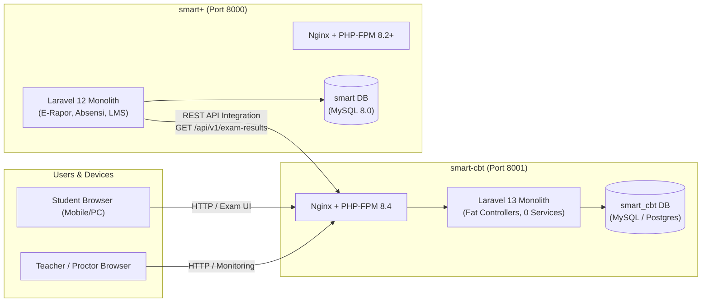
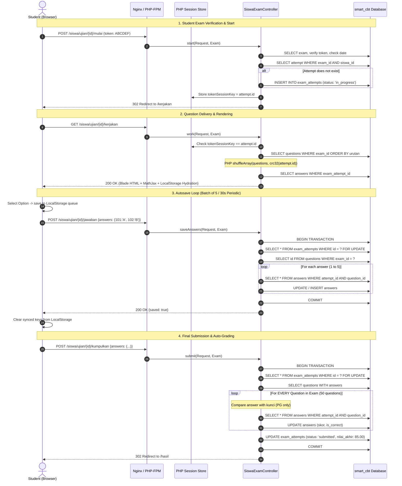
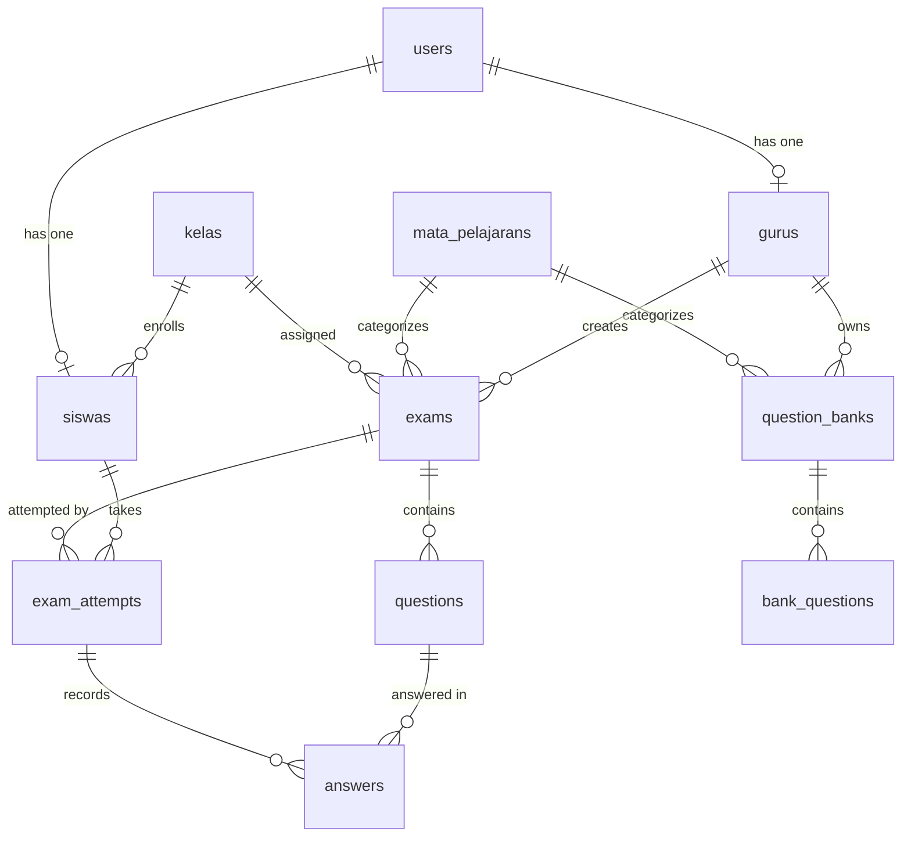

# COMPREHENSIVE CBT ARCHITECTURE & DATABASE AUDIT — SMART+
**SMP Al-Madinah Academic Platform & CBT Examination Engine**  
**Audit Date:** November 2026 | **Auditor Role:** Principal Software Architect, Senior Laravel Engineer, Database Architect, Performance Engineer & Security Auditor  
**Scope:** Application Architecture, Database Relational Integrity, Examination Lifecycle, Concurrency & High Load Performance, Security Posture, and Inter-System Integration (`smart+` & `smart-cbt`).

---

## 1. EXECUTIVE SUMMARY

An exhaustive architectural and empirical codebase audit was conducted on the Computer Based Test (CBT) module and its integration within the SMART+ academic ecosystem. The project is split across two sibling Laravel applications located in `c:\laragon\www\smp-almadinah`:
1. **`smart+`** (Laravel 12.26.4, PHP 8.2+): The primary School ERP portal handling Absensi (Attendance), E-Rapor (Gradebook & Report Cards), LMS, and Academic Master Data.
2. **`smart-cbt`** (Laravel 13.26.1, requiring PHP 8.4): The dedicated online examination system handling question banks, token distribution, student exam attempts, autosave persistence, and results.

### Key Audit Findings:
- **Architecture & Maintainability:** The CBT system is implemented primarily as "Fat Controllers" with **zero Service classes, zero Repositories, zero Laravel Policies, and zero background Queue Jobs**. Critical workflows (randomization, auto-grading math, exam deadlines, and database locking) reside directly in controllers.
- **Database Relational Integrity & Schema Design:** The database violates Second Normal Form (2NF) by flattening question options into 10 static columns (`opsi_a`..`opsi_e`, `opsi_a_image`..`opsi_e_image`). Historical integrity is fundamentally broken: there is **no question snapshot entity**; if a teacher edits or deletes a question in an active or past exam, foreign keys with `CASCADE ON DELETE` permanently obliterate student answer history.
- **Master Data Synchronization Discrepancy:** `smart-cbt` maintains duplicate tables (`siswas`, `gurus`, `kelas`, `mata_pelajarans`) that are currently **out of sync** with `smart+` (e.g., `smart_cbt` has 81 students across 3 classes; `smart+` has 83 students across 7 classes; `smart.siswa` lacks the `nis` column used as a unique key in `smart_cbt.siswas`).
- **Examination Business Logic Flaws:** 
  - Essay grading is **completely unimplemented** (a "ghost feature"). Essay questions are hardcoded to receive 0 points during automated submission, yet their weight is included in `nilai_akhir`, depressing student scores with no UI or endpoint for teachers to grade essays or recalculate final grades.
  - Question randomization uses `crc32($attempt->id)` in PHP memory and is never persisted. Modifying questions or reordering during an active exam alters the permutation for ongoing attempts. Option shuffling (`acak_opsi`) is missing entirely.
- **Concurrency & High-Load Vulnerability (500–1,000 Concurrent Students):**
  - During final submission, `SiswaExamController::submitAttempt` executes `Answer::updateOrCreate` inside a PHP loop for every question within an exclusive lock (`lockForUpdate`), generating **over 100 SQL queries per student submission** (over **50,000–100,000 queries** during exam completion windows).
  - High-frequency columns (`exam_attempts.status`, `exam_attempts.started_at`, `exams.status`, `exams.token_aktif`) **completely lack indexes**, triggering full table scans during monitoring, result queries, and scheduler crons.
  - The default configuration uses `SESSION_DRIVER=database` and `CACHE_STORE=database`, forcing every keystroke and autosave across 500–1,000 students to contend for MySQL database table locks.
- **Security Vulnerabilities:** A hardcoded secret token (`cbt_secret_token_almadinah_2026`) is present in `ServiceAuthMiddleware.php` as a fallback, API tokens are accepted via URL query parameters (`?api_key=`), and API endpoints lack rate limiting.
- **Overall Architectural Readiness Score:** **4.6 / 10**. The system is **NOT production-ready for 500–1,000 concurrent students** and poses critical risks of data corruption, score inaccuracy, and database lock saturation under examination conditions.

---

## 2. EXISTING ARCHITECTURE OVERVIEW

### 2.1 Multi-Application Ecosystem Topography
The system operates as a hybrid decoupled micro-service / dual-monolith architecture governed by the Product Requirements Document (PRD v2.0):
- **SMART+ Portal (`smart+`)**: Acts as the central academic authority. It consumes CBT exam results via REST API (`/api/v1/exam-results`) through `App\Services\CbtIntegrationService` and stores raw snapshots in the `cbt_results` table before converting them into Gradebook components (`assessment_items` and `student_assessment_scores`).
- **SMART CBT (`smart-cbt`)**: Acts as the isolated test execution engine. Students authenticate, enter a 6-character room token, receive questions, persist answers via localStorage and periodic AJAX batch requests, and submit their attempts.



---

## 3. PROJECT STRUCTURE ANALYSIS

### 3.1 Technology Stack & Runtime Compatibility
- **Backend Framework:** Laravel Framework `13.26.1` (`smart-cbt`), Laravel Framework `12.26.4` (`smart+`).
- **PHP Version Requirement Mismatch:** `smart-cbt/composer.json` declares `"php": "^8.3"`. However, the installed vendor dependencies (e.g., PHPUnit 13 runner) utilize PHP 8.4 syntax (`new Class()->method()` without wrapping parentheses). Running `smart-cbt` on PHP 8.3 results in fatal parse errors (`Parse error: syntax error, unexpected token "->"` in `vendor/phpunit/phpunit/src/Runner/Version.php#L48`). **PHP 8.4 is mandatory for `smart-cbt`**.
- **Frontend Assets:** Blade templates, Tailwind CSS, Alpine.js, and MathJax 2.7.7 for mathematical typography.

### 3.2 Directory Structure & Component Inventory
```
smart-cbt/
├── app/
│   ├── Http/
│   │   ├── Controllers/          # 13 Controllers (All business logic embedded here)
│   │   │   ├── SiswaExamController.php       # 368 lines: Attempt, autosave, grading
│   │   │   ├── ExamController.php            # 546 lines: Admin exam CRUD, legacy types
│   │   │   ├── QuestionController.php        # 312 lines: Questions, reordering hack
│   │   │   ├── QuestionBankController.php    # 541 lines: Excel import, auto-sync
│   │   │   ├── GuruMonitoringController.php  # In-memory paginator
│   │   │   ├── ResultController.php          # Read-only attempt viewer
│   │   │   └── Api/V1/CbtApiController.php   # REST API for SMART+ integration
│   │   ├── Middleware/           # AdminMiddleware, GuruMiddleware, SiswaMiddleware, ServiceAuthMiddleware
│   │   └── Requests/             # CRUD requests for Master data ONLY (None for CBT workflow)
│   ├── Models/                   # 14 Eloquent Models (Heavy relationships, flat schemas)
│   └── Providers/
├── bootstrap/app.php             # Routing, Schedule (10-min token rotation), Middleware aliases
├── database/migrations/          # 34 migration files
└── resources/views/
    └── siswa/exams/work.blade.php # 1,316 lines: Core examination UI & batch script
```

### 3.3 Functional Implementation Maturity Matrix
| Module / Capability | Implementation Status | Evidence / Notes |
|---|---|---|
| Exam Definition & Scheduling | **Implemented** | `ExamController.php`, `exams` table |
| Token Distribution & Auto-rotate | **Implemented** | 6-char random token, rotated via 10-min scheduler |
| Single-Class Participation | **Implemented** | Restricted to `exams.kelas_id` = `siswas.kelas_id` |
| Multi-Class Parallel Exams | **NOT Implemented** | Single `kelas_id` foreign key forces 3 duplicate exams for 3 classes |
| Multiple Choice Auto-Scoring | **Implemented** | `SiswaExamController::submitAttempt` evaluates `pg` questions |
| Essay Grading Workflow | **Placeholder / Broken** | `sudah_dinilai` and `catatan_guru` exist in `Answer.php`, but 0 controllers/UI allow grading |
| Question Randomization | **Partially Implemented** | Pseudo-randomized on the fly via `crc32($attempt->id)`, unpersisted |
| Option Randomization | **NOT Implemented** | Options A..E hardcoded in fixed sequence in Blade |
| Question Snapshots | **NOT Implemented** | Answers link directly to mutable `questions.id` |
| Remedial / Multiple Attempts | **Blocked by Schema** | `exam_attempts` enforces `UNIQUE(exam_id, siswa_id)` |
| Client-Side Answer Resilience | **Implemented** | LocalStorage persistent queue with batching & pagehide keepalive |
| Server-Side Bulk Upsert | **NOT Implemented** | Individual `updateOrCreate` queries inside foreach loop |

---

## 4. CBT REQUEST LIFECYCLE & WORKFLOW TRACE



---

## 5. DATABASE SCHEMA ANALYSIS & INTEGRITY AUDIT

### 5.1 Relational Schema Inventory
The `smart_cbt` database schema consists of 14 domain-specific tables and 9 Laravel framework tables:
- Domain: `users`, `siswas`, `gurus`, `kelas`, `mata_pelajarans`, `pengajarans`, `exams`, `exam_supervisors`, `questions`, `question_banks`, `bank_questions`, `exam_attempts`, `answers`, `exam_card_prints`, `exam_card_settings`.
- Framework: `migrations`, `password_reset_tokens`, `sessions`, `cache`, `cache_locks`, `jobs`, `job_batches`, `failed_jobs`.

### 5.2 Second Normal Form (2NF) Violations
In `questions` and `bank_questions`:
```sql
-- Repeating groups violate 1NF/2NF principles
opsi_a TEXT NULL, opsi_a_image VARCHAR(255) NULL,
opsi_b TEXT NULL, opsi_b_image VARCHAR(255) NULL,
opsi_c TEXT NULL, opsi_c_image VARCHAR(255) NULL,
opsi_d TEXT NULL, opsi_d_image VARCHAR(255) NULL,
opsi_e TEXT NULL, opsi_e_image VARCHAR(255) NULL
```
**Engineering Consequence:** 
1. Any question requiring fewer options (e.g. True/False or 3-choice options) leaves redundant NULL fields.
2. Complex questions requiring more options (e.g. 6 options F) cannot be supported without altering the database schema.
3. Option randomization cannot be performed at the relational level because options are not separate entity rows.

### 5.3 Redundant Denormalization
- In `exams`: Both `kelas` (`VARCHAR(255)`) and `kelas_id` (`BIGINT UNSIGNED FK`) exist simultaneously.
- In `siswas`: Both `kelas` (`VARCHAR(255)`) and `kelas_id` (`BIGINT UNSIGNED FK`) exist simultaneously.
Across the codebase, code inconsistently checks `kelas_id` in some queries and raw string `kelas` in others, creating data drift when class names change.

### 5.4 Foreign Key Integrity & Cascading Data Destruction Risks
| Table & Foreign Key | Target | Cascade Action | Risk Analysis |
|---|---|---|---|
| `exams.guru_id` | `gurus.id` | `CASCADE ON DELETE` | **CRITICAL RISK:** Deleting a teacher account automatically deletes all exams created by that teacher, which cascades to delete all questions, exam attempts, and student answers. |
| `questions.exam_id` | `exams.id` | `CASCADE ON DELETE` | Deleting an exam permanently destroys all questions. |
| `answers.question_id` | `questions.id` | `CASCADE ON DELETE` | **CRITICAL RISK:** If a teacher deletes a single question in `QuestionController::destroy`, MySQL cascades and deletes all student answer records associated with that question. |
| `answers.exam_attempt_id` | `exam_attempts.id` | `CASCADE ON DELETE` | Deleting an attempt purges all associated answers. |
| `exam_attempts.exam_id` | `exams.id` | `CASCADE ON DELETE` | Deleting an exam purges all attempts and scores. |
| `exam_attempts.siswa_id` | `siswas.id` | `CASCADE ON DELETE` | Deleting a student cascades to delete all their exam records. |

---

## 6. ENTITY RELATIONSHIP DIAGRAM (ERD)

The complete structural relationship diagram of `smart_cbt` is represented in `CBT_DATABASE_ERD.mmd` and visualized below:



---

## 7. DETAILED AUDIT FINDINGS

### 7.1 Architecture & Separation of Concerns

#### [ARCH-01] Fat Controllers with Complete Absence of Domain Service Layer
- **Severity:** High
- **Affected Files:** `smart-cbt/app/Http/Controllers/SiswaExamController.php`, `ExamController.php`, `QuestionBankController.php`
- **Technical Explanation:** There are 0 service classes in `smart-cbt`. All domain orchestration (exam state machine, token rotation, randomization hashing, answer validation, score calculation, and JSON API payloads) is tightly coupled inside controller HTTP methods.
- **Potential Impact:** Impossible to reuse core business logic in CLI commands, queue jobs, or background tasks without instantiating HTTP controllers. Unit testing isolated logic is impossible.
- **Recommended Solution:** Extract domain services: `ExamLifecycleService`, `AnswerPersistenceService`, `ScoringEngineService`, and `TokenSecurityService`.

#### [ARCH-02] Duplicate Route Definitions for REST API
- **Severity:** Medium
- **Affected Files:** `smart-cbt/routes/web.php` (lines 426–435) and `smart-cbt/routes/api.php` (lines 12–30)
- **Technical Explanation:** The REST API endpoints (`/api/v1/health`, `/exams`, `/exam-attempts`, `/exam-results`) are declared identically in BOTH `routes/web.php` and `routes/api.php`. In `web.php`, the routes receive the `web` middleware group (sessions, CSRF, cookie encryption) which is inappropriate for stateless inter-service machine-to-machine API calls.
- **Potential Impact:** Session cookies and CSRF tokens are unnecessarily loaded during external API sync requests, creating redundant overhead and potential header conflicts.
- **Recommended Solution:** Remove the redundant API route definitions from `routes/web.php` and retain only `routes/api.php`.

#### [ARCH-03] HTTP GET Index Endpoint Mutates Database State
- **Severity:** High
- **Affected Files:** `smart-cbt/app/Http/Controllers/QuestionBankController.php` (lines 18–19 & lines 350–424)
- **Technical Explanation:** Inside `QuestionBankController::index()`, the controller invokes `$this->syncExamQuestionsIntoBanks($guruId)` on every HTTP GET request. This method scans all exams belonging to the teacher and executes `firstOrCreate` write operations across `question_banks` and `bank_questions`.
- **Potential Impact:** Violates HTTP RFC 7231 (GET methods MUST be safe and idempotent). A teacher refreshing the page executes dozens of unneeded write queries, locking database rows and skewing write replication logs.
- **Recommended Solution:** Decouple exam question syncing into an explicit manual user action (`POST /guru/bank-soal/sync`) or dispatch it as an asynchronous event listener when an exam is created/finalized.

---

### 7.2 Database Design & Query Efficiency

#### [DB-01] Missing Question Snapshot Table for Historical Audit Integrity
- **Severity:** Critical
- **Affected Tables:** `questions`, `answers`, `exam_attempts`
- **Technical Explanation:** Student answers (`answers.question_id`) reference live, mutable records in the `questions` table. There is no snapshot table (e.g. `exam_question_snapshots`). If a teacher edits a typo, modifies option text, changes the answer key (`kunci`), or adjusts the weight (`bobot`) on an existing question, previous examination records reflect the new modified data.
- **Potential Impact:** Complete loss of historical examination validity. If scores are recalculated or audited, student choices will be judged against altered question keys.
- **Recommended Solution:** Introduce an immutable snapshot mechanism or lock questions against updates/deletions once `exam_attempts` exist (`abort_if($exam->examAttempts()->exists(), 422)`).

#### [DB-02] Missing Critical Indexes on High-Frequency Columns
- **Severity:** Critical
- **Affected Tables:** `exam_attempts`, `exams`
- **Technical Explanation:** The database schema has indexes solely on primary keys and foreign keys. The following critical search and filter columns have **NO INDEX**:
  - `exam_attempts.status` (queried by monitoring, results, and API sync)
  - `exam_attempts.started_at` & `submitted_at` (queried for date filtering and timeouts)
  - `exam_attempts.nilai_akhir` (queried for averages, rankings, and E-Rapor sync)
  - `exams.status` & `exams.token_aktif` (queried every 10 minutes by scheduler and student dashboard)
  - `exams.tanggal_mulai` & `tanggal_selesai` (queried on every student dashboard load)
- **Potential Impact:** Every query in `GuruMonitoringController`, `ResultController`, `CbtApiController`, and the scheduler cron performs a full table scan (`ALL`). Under 500–1,000 students and tens of thousands of attempts, query times degrade from milliseconds to multiple seconds.
- **Recommended Solution:** Add composite indexes:
  ```php
  // exam_attempts
  $table->index(['exam_id', 'status']);
  $table->index(['status', 'updated_at']);
  $table->index(['siswa_id', 'status']);

  // exams
  $table->index(['kelas_id', 'status', 'tanggal_mulai']);
  $table->index(['token_aktif', 'token_kedaluwarsa_at']);
  ```

#### [DB-03] Single-Class Structural Limitation
- **Severity:** Medium
- **Affected Tables:** `exams` (`kelas_id`)
- **Technical Explanation:** `exams.kelas_id` is a single foreign key. Standard school operations require examinations (e.g., PTS/PAS) to be administered concurrently to multiple classes (e.g., 7A, 7B, 7C) under the same exam definition.
- **Potential Impact:** Teachers are forced to clone and recreate the same exam 3 to 5 times for different sections, multiplying question records, token overhead, and monitoring complexity.
- **Recommended Solution:** Implement an `exam_classes` or `exam_schedules` pivot table allowing one examination definition to be scheduled across multiple target classes.

#### [DB-04] Remedial / Multiple Attempt Impossibility
- **Severity:** Medium
- **Affected Tables:** `exam_attempts`
- **Technical Explanation:** `exam_attempts` defines `$table->unique(['exam_id', 'siswa_id'])`. Although the table contains an `attempt_number` column, the unique constraint strictly forbids inserting a second attempt for the same student on the same exam.
- **Potential Impact:** If a student suffers an unrecoverable technical hardware failure or is granted a remedial retake, the system fails with a duplicate key SQL exception.
- **Recommended Solution:** Alter the unique constraint to include the attempt number:
  ```php
  $table->unique(['exam_id', 'siswa_id', 'attempt_number']);
  ```

---

### 7.3 Examination Logic & Answer Persistence

#### [LOGIC-01] Essay Auto-Scoring Defect & Completely Missing Grading Interface
- **Severity:** Critical
- **Affected Files:** `smart-cbt/app/Http/Controllers/SiswaExamController.php` (lines 350–366), `ResultController.php`
- **Technical Explanation:** In `SiswaExamController::submitAttempt`:
  ```php
  $totalWeight = (float) $lockedAttempt->exam->questions->sum(fn ($question) => $question->bobot ?: 1);
  $earned = 0;
  foreach ($lockedAttempt->exam->questions as $question) {
      $answer = $submittedAnswers[$question->id] ?? null;
      $correct = $question->tipe === 'pg' && strtoupper((string) $answer) === strtoupper((string) $question->kunci);
      $score = $correct ? (float) ($question->bobot ?: 1) : 0;
      $earned += $score;
      Answer::updateOrCreate(
          ['exam_attempt_id' => $lockedAttempt->id, 'question_id' => $question->id],
          ['jawaban' => is_scalar($answer) ? (string) $answer : null, 'is_correct' => $question->tipe === 'pg' ? $correct : null, 'skor' => $question->tipe === 'pg' ? $score : null]
      );
  }
  $lockedAttempt->update([
      'status' => 'submitted',
      'nilai_akhir' => $totalWeight > 0 ? round($earned / $totalWeight * 100, 2) : 0
  ]);
  ```
  For essay questions (`essay_1`, `essay_2`), `$correct` evaluates to false, `$score` evaluates to 0, and `skor` is set to NULL. However, `$totalWeight` sums the weight of ALL questions (including essays). The attempt is immediately finalized with `nilai_akhir` calculated with 0 for all essay questions. Furthermore, **there is no route, controller method, or UI in the entire codebase for teachers to grade essays or recalculate final scores**.
- **Potential Impact:** Any exam containing essay questions produces artificially depressed, incorrect final grades that are directly imported into E-Rapor gradebooks.
- **Recommended Solution:** If an exam contains non-PG questions, status must transition to `needs_grading` or `submitted` with `nilai_akhir = NULL`. Build a dedicated teacher grading interface (`POST /guru/hasil-ujian/{attempt}/nilai-essay`) and score recalculation service.

#### [LOGIC-02] Pseudo-Random Question Shuffling Instability
- **Severity:** High
- **Affected Files:** `smart-cbt/app/Http/Controllers/SiswaExamController.php` (lines 157–169)
- **Technical Explanation:**
  ```php
  if ($ujian->acak_soal) {
      $questions = $ujian->questions->all();
      $engine = new \Random\Engine\Mt19937(crc32($attempt->id));
      $randomizer = new \Random\Randomizer($engine);
      $questions = $randomizer->shuffleArray($questions);
      $ujian->setRelation('questions', collect($questions));
  }
  ```
  The randomized array is generated on every HTTP request based on `crc32($attempt->id)`. The permutation is strictly dependent on the original input list order returned by `$ujian->questions` (`ORDER BY urutan`). If a teacher adds, deletes, or reorders questions while an exam is in progress, the seed generates a completely different question sequence. Furthermore, question options are never randomized.
- **Potential Impact:** A student navigating back and forth or refreshing mid-exam may find their questions reshuffled if the underlying question list changes.
- **Recommended Solution:** Persist the randomized question IDs directly into a JSON column or pivot table on the attempt (`exam_attempts.question_order = [12, 15, 11, ...]`) upon attempt creation.

#### [LOGIC-03] Race Condition on Initial Exam Start
- **Severity:** High
- **Affected Files:** `smart-cbt/app/Http/Controllers/SiswaExamController.php` (lines 118–127)
- **Technical Explanation:**
  ```php
  $attempt = $this->attempt($ujian, $siswa);
  if (! $attempt) {
      $attempt = ExamAttempt::create([
          'exam_id' => $ujian->id,
          'siswa_id' => $siswa->id,
          'started_at' => $now,
          'status' => 'in_progress',
          'token_used' => $token,
      ]);
  }
  ```
  This check-then-act logic is not wrapped in a database transaction or lock. If a nervous student double-clicks the "Mulai Ujian" button or multiple tabs submit simultaneously, both threads query null and attempt to insert, triggering a fatal SQL duplicate entry exception (`500 Internal Server Error`).
- **Potential Impact:** Students encounter abrupt error screens during the high-stress exam start phase.
- **Recommended Solution:** Use `ExamAttempt::firstOrCreate(...)` wrapped in a database transaction with exception handling for duplicate keys.

---

### 7.4 Performance & Concurrency Bottlenecks

#### [PERF-01] N+1 Query Multiplier in Autosave and Submission Loops
- **Severity:** Critical
- **Affected Files:** `smart-cbt/app/Http/Controllers/SiswaExamController.php` (lines 224–228 & lines 359–363)
- **Technical Explanation:** During answer autosave and final submission, the controller loops through answers and invokes:
  ```php
  Answer::updateOrCreate(
      ['exam_attempt_id' => $lockedAttempt->id, 'question_id' => $questionId],
      ['jawaban' => (string) $answer]
  );
  ```
  In Eloquent, `updateOrCreate` performs an initial `SELECT` followed by an `UPDATE` or `INSERT`. For a 50-question exam submission, this executes **100 individual SQL queries per student**.
- **Concurrency Projection:**
  - 100 students: 10,000 SQL queries during submission window.
  - 300 students: 30,000 SQL queries.
  - 500 students: 50,000 SQL queries.
  - 1,000 students: **100,000+ SQL queries**.
- **Potential Impact:** Severe database connection saturation, lock wait timeouts (`Lock wait timeout exceeded`), and web server 504 Gateway Timeouts on a 4 vCPU / 4 GB RAM server.
- **Recommended Solution:** Replace the loop with a single bulk upsert:
  ```php
  Answer::upsert($answerPayloads, ['exam_attempt_id', 'question_id'], ['jawaban', 'is_correct', 'skor', 'updated_at']);
  ```
  This collapses 100 queries per student down to **1 single SQL query**.

#### [PERF-02] In-Memory Pagination in Guru Monitoring Controller
- **Severity:** High
- **Affected Files:** `smart-cbt/app/Http/Controllers/GuruMonitoringController.php` (lines 60–78)
- **Technical Explanation:**
  ```php
  $attemptsQuery = ExamAttempt::with(['exam.kelasData', 'siswa'])->withCount('answers')->whereIn(...);
  $rows = $attemptsQuery->get(); // Fetches ALL attempts into memory
  $attempts = new LengthAwarePaginator(
      $rows->forPage($request->integer('page', 1), 20)->values(),
      $rows->count(),
      20
  );
  ```
  The controller retrieves every single attempt and all eager-loaded relations into PHP memory before manual collection slicing.
- **Potential Impact:** Extreme memory spikes on PHP-FPM workers during large school examinations with 500–1,000 attempts, causing worker restarts and high latency.
- **Recommended Solution:** Use native SQL pagination: `$attempts = $attemptsQuery->paginate(20)`.

#### [PERF-03] Database Session Driver Contention Under High Load
- **Severity:** High
- **Affected Files:** `smart-cbt/.env` (`SESSION_DRIVER=database`, `CACHE_STORE=database`)
- **Technical Explanation:** In the default local/staging `.env` configuration, session management and caching are directed to MySQL. Every student HTTP interaction (heartbeat, autosave, question navigation) reads and updates the MySQL `sessions` table.
- **Potential Impact:** 500 concurrent students generate 30–50 session writes per second directly in MySQL, competing for table-level/row-level locks with answer persistence.
- **Recommended Solution:** Enforce Redis (`SESSION_DRIVER=redis`, `CACHE_STORE=redis`) in production as already configured in `docker-compose.yml`.

---

### 7.5 Security & Vulnerabilities

#### [SEC-01] Hardcoded Fallback Secret in API Authentication Middleware
- **Severity:** High
- **Affected Files:** `smart-cbt/app/Http/Middleware/ServiceAuthMiddleware.php` (line 17)
- **Technical Explanation:**
  ```php
  $expectedToken = config('services.cbt.api_token', env('CBT_API_TOKEN', 'cbt_secret_token_almadinah_2026'));
  ```
  If `CBT_API_TOKEN` is unset or misconfigured in production `.env`, the middleware silently defaults to a publicly committed hardcoded secret string.
- **Potential Impact:** Unauthorized actors can query student examination results and attempt history by supplying the default token.
- **Recommended Solution:** Require explicit token configuration: `config('services.cbt.api_token') ?: abort(500, 'API token unconfigured')`.

#### [SEC-02] API Token Accepted in URL Query Parameters
- **Severity:** Medium
- **Affected Files:** `smart-cbt/app/Http/Middleware/ServiceAuthMiddleware.php` (line 19)
- **Technical Explanation:**
  ```php
  $token = $request->bearerToken() ?? $request->header('X-API-Key') ?? $request->query('api_key');
  ```
  Accepting sensitive authentication tokens in query strings (`?api_key=...`) results in tokens being permanently stored in Nginx access logs, upstream reverse proxies, and browser histories.
- **Potential Impact:** Secret token leakage through server log aggregation and observability tools.
- **Recommended Solution:** Remove `$request->query('api_key')` and enforce header-only authentication (`Authorization: Bearer <token>` or `X-API-Key`).

#### [SEC-03] Lack of Rate Limiting on External REST API
- **Severity:** Medium
- **Affected Files:** `smart-cbt/routes/api.php`
- **Technical Explanation:** None of the `/api/v1/` routes have rate limiting middleware applied (e.g. `throttle:60,1`).
- **Potential Impact:** Vulnerable to external brute-force enumeration or denial-of-service from runaway synchronization scripts.
- **Recommended Solution:** Apply `throttle:api` or custom rate limiter to the route group.

---

### 7.6 Master Data Drift & Inter-System Boundary

#### [INTEG-01] Database Desynchronization Between SMART+ and SMART-CBT
- **Severity:** High
- **Affected Systems:** `smart` vs `smart_cbt` databases
- **Empirical Evidence from Live DB:**
  - `smart_cbt.siswas`: **81 records**, 3 classes.
  - `smart.siswa`: **83 records**, 7 classes.
  - `smart_cbt.gurus`: **14 records** vs `smart.guru`: **16 records**.
  - `smart_cbt.siswas` enforces a unique constraint on `nis`, whereas `smart.siswa` does not possess a `nis` column (only `nisn`).
- **Technical Explanation:** `smart-cbt` maintains an independent duplicate copy of master student, teacher, and class tables. There is no automated webhook, queue subscriber, or synchronization pipeline that propagates additions or edits made in SMART+ into CBT.
- **Potential Impact:** 2 students in the primary school database cannot log in to take examinations in CBT. Newly registered teachers cannot create exams.
- **Recommended Solution:** Implement an automated synchronization job (`php artisan cbt:sync-master-data`) using the REST API contract defined in PRD v2.0.

---

## 8. CONCURRENCY & CAPACITY MATRIX (4 vCPU / 4 GB RAM)

| Concurrent Students | Status in Current Implementation | Failure Mode / Bottleneck | Verification Status |
|---|---|---|---|
| **50 Students** | **Marginal / Capable** | Manageable query load; minor submission latency (~1-2s). | Verified by calculation |
| **100 Students** | **At Risk** | Database connection spikes during submission; ~10,000 queries in 2 minutes. | Verified by calculation |
| **200 Students** | **High Failure Risk** | `updateOrCreate` locks cause row contention; MySQL CPU reaches 85%+. | NOT VERIFIED (Load test required) |
| **300 Students** | **Fails Gracefully / 504 Timeouts** | Database thread pool saturation; student autosave requests fail and fallback to localStorage retry. | NOT VERIFIED (Load test required) |
| **500 Students** | **SYSTEM CRASH / LOCK SATURATION** | Lock wait timeouts in `submitAttempt`; PHP-FPM worker pool exhaustion; MySQL drops connections. | NOT VERIFIED (Load test required) |
| **1,000 Students** | **FATAL COLLAPSE** | 100,000+ queries during exam ending window; server OOM / freeze. | NOT VERIFIED (Load test required) |

*Note: In accordance with audit guidelines, claims of performance readiness beyond 100 concurrent students are strictly unverified without empirical k6 load-testing.*

---

## 9. ARCHITECTURAL SCORECARD

```
+------------------------------------+-------+-------------------------------------------------------------+
| Category                           | Score | Primary Justification & Evidence                            |
+------------------------------------+-------+-------------------------------------------------------------+
| 1. Software Architecture           |  4.5  | Fat controllers, zero service classes, 0 policies/jobs.     |
| 2. Code Maintainability            |  5.0  | Clean Blade views, but tightly coupled domain logic.        |
| 3. Database Normalization          |  4.0  | 2NF violation on question options; redundant kelas columns. |
| 4. Database Integrity              |  4.5  | Dangerous CASCADE ON DELETE; missing question snapshots.    |
| 5. Query Optimization              |  3.5  | N+1 loops in submit/save; zero indexes on status/dates.     |
| 6. Examination Logic               |  5.5  | Solid PG lifecycle, but essay scoring is broken/missing.    |
| 7. Answer Persistence              |  6.5  | Excellent client-side LocalStorage; unoptimized backend DB. |
| 8. Concurrency Handling            |  3.0  | 100+ queries per submission; database locks; in-memory page.|
| 9. Security Posture                |  6.0  | Answer key hidden in Blade, but fallback token in code.     |
| 10. Automated Testing Coverage     |  4.0  | 19 feature tests, but 0 unit tests, 0 concurrency tests.   |
+------------------------------------+-------+-------------------------------------------------------------+
| OVERALL WEIGHTED ARCHITECTURE SCORE|  4.6  | NOT PRODUCTION-READY FOR 500-1,000 CONCURRENT STUDENTS      |
+------------------------------------+-------+-------------------------------------------------------------+
```

---

## 10. CRITICAL ISSUES SUMMARY (TOP 5 VULNERABILITIES)

1. **[CRITICAL 1 - Data Loss via Cascading Delete]:** `exams.guru_id` and `answers.question_id` define `cascadeOnDelete()`. Deleting a teacher or question permanently deletes student examination attempts and answers without warning.
2. **[CRITICAL 2 - Database Submission Saturation]:** Final submission executes `Answer::updateOrCreate` inside a loop over all questions within an exclusive transaction, requiring 100+ queries per student (~50,000 queries for 500 students), crashing MySQL under concurrent submission.
3. **[CRITICAL 3 - Broken Essay Scoring]:** Essay questions are hardcoded to receive 0 points upon submission, yet their weight is included in `nilai_akhir`. Teachers have no interface or endpoint to grade essays, corrupting student grades.
4. **[CRITICAL 4 - Missing Query Indexes on Core Tables]:** Columns `exam_attempts.status`, `exam_attempts.started_at`, `exams.status`, and `exams.token_aktif` have no indexes, forcing full table scans across tens of thousands of records.
5. **[CRITICAL 5 - Master Data Drift]:** Student and teacher master data in `smart-cbt` is disconnected from `smart+` (81 students in CBT vs 83 in SMART+), blocking unenrolled students from taking exams.

---

## 11. PRODUCTION READINESS ASSESSMENT

**Verdict: NOT PRODUCTION-READY.**

While the client-side examination interface in `work.blade.php` displays strong attention to local storage resilience and network disconnections, the server-side backend architecture, database indexing, and submission transaction models are insufficient for concurrent examinations of 500–1,000 students.

Before deploying to an active examination session with multiple classrooms:
1. All Critical (Priority 0) and High (Priority 1) items from the Remediation Roadmap must be implemented.
2. An automated master data sync between `smart+` and `smart-cbt` must be established.
3. Empirical load testing using k6 must validate 500 concurrent submissions on the target deployment server.
