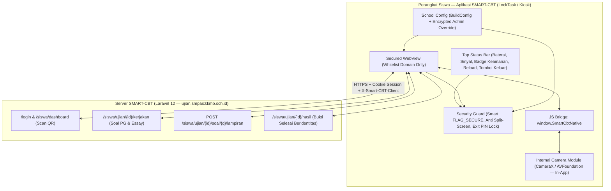

# Product Requirements Document (PRD)
## SMART-CBT — Mobile Exam Browser (Android & iOS)

| Metadata | Detail |
| :--- | :--- |
| **Nama Produk** | **SMART-CBT** |
| **Versi Dokumen** | 1.0 |
| **Tanggal** | 24 November 2026 |
| **Target Default Sekolah** | SMP Al-Madinah (`https://ujian.smpaickkmb.sch.id`) |
| **Model Distribusi** | White-Label Ready (dapat diganti domain & branding untuk sekolah lain) |
| **Tahap 1 (Prioritas)** | Aplikasi Android Native (`.apk` / `.aab`) — Target pengerjaan: **2 Hari** |
| **Tahap 2 (Lanjutan)** | Aplikasi iOS Native (`.ipa` / TestFlight / App Store) |
| **Integrasi Backend** | Laravel 12 (`smart-cbt/` dalam monorepo `smp-almadinah`) |

---

## 1. Latar Belakang & Masalah

Platform ujian online **SMART-CBT** memiliki fitur unggulan berupa **Scan QR Ujian** di dashboard siswa dan **Upload Foto Jawaban Essay** (`essay_1` & `essay_2`) di halaman pengerjaan ujian. Ketika diuji menggunakan aplikasi **Exambro Android pihak ketiga** (dari Play Store):

1. **Kamera Diblokir oleh Exambro Pihak Ketiga**: APK Exambro umum berjalan di atas `android.webkit.WebView` dalam mode *LockTask / Kiosk* tanpa mengizinkan `WebChromeClient.onPermissionRequest` (WebRTC) dan memblokir intent kamera eksternal (`<input type="file" capture="environment">`). Akibatnya, siswa tidak bisa memfoto kertas jawaban essay.
2. **Konflik Kebutuhan Screenshot**: Exambro umum memblokir screenshot di seluruh halaman secara kaku, padahal setelah ujian selesai (`/siswa/ujian/{ujian}/hasil`), siswa perlu mengambil **screenshot bukti selesai** (yang memuat Nama Peserta, NISN/NIS, Kelas, Status Pengumpulan, Waktu Mulai, dan Waktu Selesai) untuk laporan/arsip ke guru.
3. **Kebutuhan Kontrol Keluar Berbasis Kode Guru**: Siswa tidak boleh keluar dari aplikasi ujian secara bebas (baik saat masih mengerjakan maupun setelah selesai) sebelum memasukkan **Kode Akses Keluar** yang diberikan oleh guru/pengawas.
4. **Kebutuhan Multi-Sekolah (Reusable)**: Aplikasi harus terkunci mati pada domain `https://ujian.smpaickkmb.sch.id` untuk pemakaian operasional, namun menyediakan mekanisme pergantian domain yang aman agar dapat digunakan ulang di sekolah lain tanpa menulis ulang aplikasi.

---

## 2. Tujuan Produk

1. Menghadirkan aplikasi mobile exam browser bernama **SMART-CBT** yang **mengunci perangkat selama ujian** (anti-pindah aplikasi, anti split-screen, anti floating window, anti screenshot soal).
2. Memastikan fitur **Kamera Jawaban Essay** dan **Scan QR Ujian** **100% terbuka dan berjalan mulus** di dalam aplikasi tanpa keluar dari mode kunci ujian (mendukung HTTPS maupun HTTP lokal saat testing).
3. Menerapkan **Kontrol Screenshot Pintar**: memblokir screenshot saat ujian berlangsung (`/kerjakan`) dan mengizinkan screenshot hanya saat siswa berada di halaman **Bukti Selesai Ujian** (`/hasil`).
4. Mengunci aksi **Keluar Aplikasi** secara ketat menggunakan **Password / Kode Akses Guru**.
5. Menyediakan arsitektur **White-Label** sehingga domain default terkunci di `https://ujian.smpaickkmb.sch.id`, namun dapat diganti dengan mudah untuk sekolah lain.
6. Menjalankan pengembangan secara bertahap: **Tahap 1 Android** (siap produksi dalam 2 hari), dilanjutkan **Tahap 2 iOS** dengan kontrak JS Bridge yang seragam.

---

## 3. Ruang Lingkup & Tahapan

### Tahap 1 — Android Native (Kotlin)
- Direktori proyek: `smart-cbt-mobile/android/`
- Target SDK: Android 8.0 (API 26) s.d. Android 15 (API 35)
- Output: Signed Release `.apk` (`SMART-CBT-v1.0.apk`) + konfigurasi CI build otomatis.
- Integrasi ringan (~25 baris JS) di `smart-cbt/resources/views/siswa/exams/work.blade.php` untuk mendeteksi dan memanggil `window.SmartCbtNative`.

### Tahap 2 — iOS Native (Swift)
- Direktori proyek: `smart-cbt-mobile/ios/`
- Target OS: iOS / iPadOS 15.0+
- Menggunakan `WKWebView`, `AVFoundation` Native Camera Bridge, `WKUIDelegate` WebRTC camera grant, dan Apple **Automatic Assessment Configuration (`AEAssessmentSession`)** / Guided Access.
- Menggunakan kontrak JavaScript Bridge yang **100% identik** dengan Tahap 1 Android sehingga web `smart-cbt` tidak perlu diubah lagi.

---

## 4. Arsitektur Teknis & Alasan Pemilihan Stack

### Mengapa Native (Kotlin + Swift) dengan Shared JS Bridge Contract?
Pada aplikasi Exambro, ~90% fungsionalitas inti bergantung langsung pada API keamanan level sistem operasi:
- **Android**: `startLockTask()`, `FLAG_SECURE`, `WebChromeClient.onPermissionRequest`, `CameraX`, `onWindowFocusChanged`, `isInMultiWindowMode`.
- **iOS**: `AEAssessmentSession`, `WKWebView` `WKUIDelegate`, `UIScreen.capturedDidChangeNotification`, `AVFoundation`.

Pendekatan **Native per platform** dengan satu kontrak bridge (`window.SmartCbtNative`) menghasilkan:
- Ukuran APK sangat ringan (**~5–8 MB** vs ~35+ MB jika memakai framework hybrid), sangat krusial saat ratusan siswa mengunduh serentak di Wi-Fi sekolah.
- Nol konflik lifecycle antara Kiosk/LockTask, `FLAG_SECURE`, dan WebView.
- Kamera internal (`CameraX` / `AVFoundation`) berjalan langsung di dalam proses aplikasi sehingga **tidak memicu keluar dari Kiosk/LockTask** dan **tetap berfungsi di HTTP maupun HTTPS**.

### Diagram Alur Arsitektur



---

## 5. Spesifikasi Fitur Detail

### 5.1. Kunci Domain & Opsi Pergantian Domain (Multi-Sekolah)
- **Domain Default Terkunci**: `https://ujian.smpaickkmb.sch.id`
- **Strict Domain Whitelist**:
  - WebView **hanya** mengizinkan navigasi ke host yang cocok dengan domain aktif (misalnya `ujian.smpaickkmb.sch.id`).
  - Tautan eksternal (`target="_blank"`, `window.open`, WhatsApp, Google, YouTube, intent `tel:`, `mailto:`, dll.) diblokir sepenuhnya di dalam `shouldOverrideUrlLoading`.
  - Pengecualian aset CDN read-only (hanya subresource seperti MathJax / `html5-qrcode` jika masih dipakai, bukan navigasi halaman utama).
- **2 Opsi Pergantian Domain (Agar Bisa Dipakai di Sekolah Lain)**:
  1. **Build-Time White-Label Config (`school.properties`)**:
     - Satu file konfigurasi untuk mengubah `APP_NAME`, `APPLICATION_ID`, `DEFAULT_BASE_URL`, `ALLOWED_HOSTS`, `DEFAULT_EXIT_PIN`, dan `ADMIN_SETTINGS_PIN`.
     - Cocok saat mem-build APK permanen khusus untuk sekolah baru.
  2. **Runtime Hidden Operator Settings (Opsional & Terkunci Admin PIN)**:
     - Tersembunyi dari siswa (tidak tampil sebagai tombol biasa). Hanya muncul dengan gesture rahasia (misalnya **tap 7x pada teks versi/logo `SMART-CBT`** di layar pre-flight/login atau menekan lama ikon gembok 3 detik) lalu wajib memasukkan **Admin Setup PIN** (berbeda dari Kode Keluar Guru).
     - Setelah terverifikasi, teknisi/operator dapat mengganti **URL Domain Server** dan **Kode Keluar Guru**, lalu disimpan terenkripsi menggunakan `EncryptedSharedPreferences` (Android) / Keychain (iOS).
     - Dapat dimatikan total via flag build `ENABLE_RUNTIME_DOMAIN_SWITCH=false` jika ingin 100% immutable.

---

### 5.2. Kontrol Screenshot Pintar (Route-Aware `FLAG_SECURE`)
Aplikasi memantau perubahan URL aktif WebView secara real-time (`onPageStarted`, `doUpdateVisitedHistory`, dan JS `popstate`/route observer):

| Pola URL Route | Mode Layar | Screenshot & Screen Record | Keluar Aplikasi |
| :--- | :--- | :--- | :--- |
| `/siswa/ujian/{id}/kerjakan` | **Exam Lockdown** | **DIBLOKIR** (`FLAG_SECURE` ON) | **Wajib Kode Akses Guru** |
| `/siswa/ujian/{id}/token` | **Exam Lockdown** | **DIBLOKIR** (`FLAG_SECURE` ON) | **Wajib Kode Akses Guru** |
| `/siswa/ujian/{id}/hasil` | **Bukti Selesai** | **DIIZINKAN** (`FLAG_SECURE` OFF) | **Tetap Wajib Kode Akses Guru** |
| `/login`, `/siswa/dashboard`, `/siswa/ujian`, `/siswa/riwayat-ujian` | **Portal Ujian** | **DIBLOKIR** (`FLAG_SECURE` ON) *(default aman)* | **Wajib Kode Akses Guru** |

- Pada halaman `/siswa/ujian/{id}/hasil`, top bar menampilkan badge hijau kecil **"Screenshot Diizinkan"** agar siswa tahu mereka sudah boleh mengambil tangkapan layar bukti selesai (yang menampilkan Nama Peserta, NISN/NIS, Kelas, Status Pengumpulan, Waktu Mulai, dan Waktu Selesai).
- Begitu siswa kembali ke `/siswa/ujian` atau halaman lain, `FLAG_SECURE` otomatis aktif kembali.

---

### 5.3. Kunci Keluar Aplikasi dengan Kode Akses Guru (Proctor Exit Password)
- Tombol fisik/gestur **Back**, **Home**, dan **Recent Apps** dicegah selama sesi Exambro aktif (melalui `startLockTask()` + `OnBackPressedCallback`).
- Untuk keluar dari aplikasi `SMART-CBT`, siswa **harus** menekan tombol **Keluar** di pojok kanan atas bar, lalu muncul modal **"Masukkan Kode Akses Keluar dari Guru/Pengawas"**.
- **Aturan Keamanan Dialog Keluar**:
  - Jika kode salah: tampilkan pesan error, catat jumlah percobaan gagal, dan terapkan jeda (cooldown 5 detik setelah 3x salah) agar siswa tidak bisa menebak acak.
  - Jika kode benar: hentikan `stopLockTask()`, bersihkan clipboard & cache sementara sesi jika perlu, lalu tutup aplikasi (`finishAndRemoveTask()`).
- **Manajemen Kode Akses**:
  - Tahap 1: Menggunakan **Kode Akses Keluar** yang dikonfigurasi pada `school.properties` (disimpan sebagai SHA-256 hash di dalam APK) dan dapat diubah oleh teknisi melalui Hidden Operator Settings (jika diaktifkan).
  - Opsional (Tahap 1.5 / Backend Enhancement): Sinkronisasi kode keluar dinamis dari endpoint server `GET /api/v1/exambro/config` agar guru dapat mengganti kode keluar langsung dari panel admin/guru tanpa menyentuh HP siswa (dengan fallback ke kode offline jika jaringan terputus).

---

### 5.4. Sistem Kamera Dual-Path (100% Tembus di Dalam Exambro)
Agar kamera jawaban essay dan scan QR **pasti berjalan** di seluruh perangkat Android/iOS tanpa melanggar mode Kiosk:

#### Path 1 — Native Internal Camera Bridge (Utama untuk Foto Jawaban Essay)
1. Di halaman soal (`smart-cbt/resources/views/siswa/exams/work.blade.php`), fungsi `openEmbeddedCamera(questionId, replaceAttachmentId)` mengecek keberadaan `window.SmartCbtNative`.
2. Jika aplikasi berjalan di dalam APK `SMART-CBT`, WebView memanggil:
   ```js
   window.SmartCbtNative.openEssayCamera(String(questionId), replaceAttachmentId ? String(replaceAttachmentId) : '');
   ```
3. APK membuka layar **Kamera Internal (CameraX di Android / AVFoundation di iOS)** sebagai overlay/Activity internal di dalam task yang sama (tetap berada di dalam `LockTask` Kiosk, tidak meluncurkan aplikasi kamera eksternal).
4. Fitur layar kamera internal:
   - Live viewfinder kamera belakang (default), tombol flash/torch, tombol fokus tap-to-focus, tombol jepret, dan tombol putar/ulangi di layar preview.
   - Kompresi otomatis di sisi native sebelum dikirim ke WebView: resize sisi terpanjang maksimal **1600 px**, format **JPEG quality 80%** (menjamin ukuran file jauh di bawah batas `5120 KB` / `4096x4096` di `smart-cbt/config/cbt.php`).
5. Setelah siswa menekan **"Gunakan Foto"**, native memanggil callback JS di WebView:
   ```js
   window.__onSmartCbtNativePhoto(questionId, base64JpegData, fileName, replaceAttachmentId);
   ```
6. JS di `work.blade.php` mengonversi base64 menjadi `File` (`image/jpeg`) lalu langsung memasukkannya ke fungsi `handlePhotoFilesSelected()` yang sudah ada — sehingga antrean upload XHR, progress bar, retry otomatis, dan endpoint `POST /siswa/ujian/{ujian}/soal/{question}/lampiran` bekerja **100% identik** tanpa mengubah backend Laravel.
7. **Keunggulan Mutlak**: Tetap berfungsi walaupun diuji lewat HTTP lokal maupun HTTPS, dan siswa **tidak bisa** membuka galeri HP untuk mengambil foto contekan jika mode galeri dimatikan saat ujian.

#### Path 2 — WebRTC `getUserMedia` Auto-Grant (Untuk Scan QR Ujian & Modal Kamera Web)
- Android: `WebChromeClient.onPermissionRequest` otomatis memanggil `request.grant(arrayOf(PermissionRequest.RESOURCE_VIDEO_CAPTURE))` **khusus** apabila origin request cocok dengan whitelist domain sekolah dan runtime permission `android.permission.CAMERA` sudah disetujui.
- iOS: `WKUIDelegate` (`webView(_:requestMediaCapturePermissionFor:...)`) otomatis mengembalikan `.grant` untuk origin whitelist domain sekolah.
- Dengan ini, fitur **Scan QR Ujian** (`html5-qrcode`) di `siswa/dashboard.blade.php` dan modal `#embedded-camera-modal` juga langsung berjalan mulus pada HTTPS.

#### Path 3 — Kebijakan Galeri (Anti-Cheat Foto)
- Di dalam `SMART-CBT`, tombol **"Pilih Galeri / File"** dapat disembunyikan atau diblokir secara opsional (atau hanya membuka kamera internal) agar siswa tidak bisa mengunggah foto jawaban dari galeri/WhatsApp. Default yang direkomendasikan saat ujian berlangsung: **hanya izinkan kamera langsung** (tidak membuka galeri).

---

### 5.5. Anti-Cheat & Deteksi Pelanggaran
1. **LockTask / Screen Pinning (Android)**:
   - Saat aplikasi dibuka dan masuk ke ujian, aplikasi meminta `startLockTask()` agar sistem Android mengunci layar hanya pada `SMART-CBT`.
   - Jika siswa menolak dialog Screen Pinning (pada perangkat non-MDM), tampilkan layar pemblokir *"Mode Kunci Ujian wajib diaktifkan untuk memulai"* dengan tombol **"Aktifkan Kunci Layar"** sehingga siswa tidak bisa mengerjakan soal sebelum layar terkunci.
2. **Blokir Split-Screen & Picture-in-Picture**:
   - `android:resizeableActivity="false"`, `android:supportsPictureInPicture="false"`, dan pengecekan runtime `isInMultiWindowMode`.
3. **Deteksi Kehilangan Fokus / Floating Window / Keluar Paksa**:
   - Memantau `onWindowFocusChanged`, `onPause`, dan `onUserLeaveHint`.
   - Jika terdeteksi overlay/floating app (seperti Chat Head / Floating Calculator / AI floating widget) atau siswa memaksa keluar dari Screen Pinning, aplikasi langsung menampilkan **Layar Peringatan Pelanggaran** (menutup soal di balik layar) + bunyi peringatan (beep) dan wajib konfirmasi / kode pengawas untuk lanjut (opsi bisa diatur: *peringatan 1x* atau *kunci butuh kode pengawas*).
4. **Blokir Copy-Paste, Text Selection & Zoom Tak Terkendali**:
   - Menonaktifkan long-click context menu (copy/share/web search) pada WebView serta membersihkan clipboard sistem saat masuk aplikasi.
5. **Custom User-Agent & Identifikasi Client**:
   - Menambahkan suffix User-Agent: `SmartCBT-Exambro/1.0 (Android)` (dan `(iOS)` pada Tahap 2) + custom header `X-Smart-CBT-Client: android-exambro-1.0`.

---

### 5.6. Antarmuka Pengguna (UI/UX)
- **Splash & Pre-Flight Screen**:
  - Logo & nama **SMART-CBT**
  - Pengecekan otomatis: (1) Izin Kamera, (2) Koneksi Internet ke domain server, (3) Bukan mode split-screen, (4) Aktivasi Mode Kunci Layar (`LockTask`).
  - Tombol utama **"Mulai Masuk Ujian"**.
  - Gesture rahasia (tap 7x versi di bagian bawah) -> membuka modal Admin PIN untuk mengganti domain / kode keluar (jika fitur runtime override diaktifkan).
- **Top Security Toolbar (Tinggi ~44dp, Warna Slate Gelap `#0F172A`)**:
  - Kiri: Nama **SMART-CBT** + indikator status mode (`Terkunci` warna biru/amber, berubah jadi `Screenshot OK` warna hijau saat di `/hasil`).
  - Kanan: Persentase baterai + ikon koneksi + tombol **Refresh** + tombol **Keluar** (ikon gembok).
- **Halaman Offline / Error Kustom**:
  - Jika sinyal terputus saat memuat halaman, tampilkan layar error kustom dengan tombol **"Muat Ulang"** (tidak menampilkan halaman error default WebView yang membocorkan URL/stacktrace).

---

## 6. Kontrak Integrasi dengan Backend `smart-cbt` (Laravel)

Berikut titik integrasi eksisting di repositori `smart-cbt/` yang **wajib** dijaga kompatibilitasnya:

| Komponen / Route di `smart-cbt` | Peran dalam Aplikasi Mobile `SMART-CBT` |
| :--- | :--- |
| `GET /login` | Halaman awal login siswa (session cookie Redis) |
| `GET /siswa/dashboard` | Dashboard siswa (memuat fitur Scan QR `html5-qrcode`) |
| `GET /siswa/ujian/{ujian}/token` | Input token ujian (mode `FLAG_SECURE` ON) |
| `GET /siswa/ujian/{ujian}/kerjakan` | Halaman ujian utama (`work.blade.php`, timer countdown, autosave batch, essay text & photo, `FLAG_SECURE` ON) |
| `POST /siswa/ujian/{ujian}/soal/{question}/lampiran` | Upload foto jawaban essay (`photo` multipart JPEG/PNG/WEBP max 5MB, max 4096x4096, optional `replace_attachment_id`) |
| `DELETE /siswa/ujian/{ujian}/lampiran/{attachment}` | Hapus foto jawaban essay |
| `POST /siswa/ujian/{ujian}/kumpulkan` | Submit ujian akhir (redirect ke `/hasil`) |
| `GET /siswa/ujian/{ujian}/hasil` | Bukti selesai ujian (`result.blade.php` — menampilkan Nama Peserta, NISN/NIS, Kelas, Status, Waktu Mulai & Selesai, tanpa nilai; **`FLAG_SECURE` OFF**) |

### Kontrak JavaScript Bridge (`window.SmartCbtNative`)
Harus diimplementasikan identik di Android (Tahap 1) dan iOS (Tahap 2):

```ts
// Dipanggil oleh Web (work.blade.php) -> Native App
interface SmartCbtNativeBridge {
    /** Membuka kamera internal app untuk foto jawaban essay */
    openEssayCamera(questionId: string, replaceAttachmentId: string): void;
    /** Memberitahu native platform & status halaman saat ini (opsional) */
    onRouteChanged?(pathname: string): void;
    /** Mengembalikan versi client, mis. "android-1.0.0" atau "ios-1.0.0" */
    getAppVersion(): string;
}

// Dipanggil oleh Native App -> Web (work.blade.php)
window.__onSmartCbtNativePhoto = function(
    questionId: string,
    base64Jpeg: string,         // tanpa prefix data: atau dengan data:image/jpeg;base64,
    fileName: string,           // contoh: "essay_12_1732412345.jpg"
    replaceAttachmentId: string // "" jika tambah baru, atau ID lampiran jika ganti
) { ... };

window.__onSmartCbtNativeCameraError = function(
    questionId: string,
    errorMessage: string
) { ... };
```

---

## 7. Roadmap Pengerjaan

### Tahap 1 — Android APK (Target: 2 Hari)

#### Hari 1: Fondasi, Security Lockdown & White-Label Config
1. Inisialisasi proyek Android Kotlin (`smart-cbt-mobile/android/`, Gradle Kotlin DSL, AndroidX, Material 3, CameraX).
2. Implementasi `SchoolConfig` (`school.properties` + `BuildConfig` + `EncryptedSharedPreferences` + Hidden Admin Settings dialog).
3. Implementasi `MainActivity` dengan Secured `WebView` (whitelist host `ujian.smpaickkmb.sch.id`, blokir tautan eksternal, blokir copy/paste/long-click, custom User-Agent).
4. Implementasi **Kiosk / Screen Pinning (`startLockTask`)**, blokir split-screen, anti-focus-loss overlay, dan **Smart `FLAG_SECURE`** (ON pada `/kerjakan`, OFF pada `/hasil`).
5. Implementasi Top Security Bar (baterai, status jaringan, badge mode, reload, tombol keluar) & **Dialog Kode Akses Keluar Guru** dengan rate-limit percobaan salah.

#### Hari 2: Kamera Internal CameraX, Integrasi Web & Release APK
1. Implementasi `InternalCameraOverlay` / `CameraActivity` berbasis **CameraX** (tap-to-focus, flash toggle, preview ulangi/gunakan, kompresi JPEG max 1600px quality 80%).
2. Implementasi `SmartCbtJsBridge` (`@JavascriptInterface`) + `WebChromeClient.onPermissionRequest` auto-grant kamera WebRTC untuk domain whitelist.
3. Update ringan pada `smart-cbt/resources/views/siswa/exams/work.blade.php` untuk mendeteksi `window.SmartCbtNative.openEssayCamera(...)` dan menerima callback `window.__onSmartCbtNativePhoto(...)` (plus tetap mempertahankan fallback WebRTC untuk browser biasa).
4. Tambah/update unit & feature test + build **Release APK** + setup workflow GitHub Actions untuk auto-build APK.
5. Pengujian end-to-end di perangkat Android fisik.

### Tahap 2 — iOS App (Pasca Tahap 1 Stabil)
1. Inisialisasi proyek iOS Swift (`smart-cbt-mobile/ios/`, UIKit/SwiftUI + `WKWebView`).
2. Implementasi `SchoolConfig.xcconfig` + Keychain override (Hidden Admin Settings).
3. Implementasi `WKScriptMessageHandler` dengan kontrak bridge `window.SmartCbtNative` yang identik dengan Android + `AVFoundation` internal camera controller + `WKUIDelegate` camera auto-grant.
4. Implementasi **Automatic Assessment Configuration (`AEAssessmentSession`)** untuk mode lockdown ujian iOS/iPadOS (memerlukan Apple Developer Account & entitlement `com.apple.developer.automatic-assessment-configuration`, dengan fallback Guided Access check).
5. Implementasi deteksi screen recording (`UIScreen.isCaptured`) dan notifikasi screenshot per route.
6. Distribusi via TestFlight / App Store / Apple School Manager.

---

## 8. Acceptance Criteria (Kriteria Selesai Tahap 1 — Android)

- [ ] Nama aplikasi di launcher HP Android tampil sebagai **SMART-CBT**.
- [ ] Saat dibuka, aplikasi langsung terkunci ke domain `https://ujian.smpaickkmb.sch.id` dan menolak navigasi ke situs luar (Google, YouTube, dll.).
- [ ] Operator dapat mengganti domain untuk sekolah lain melalui `school.properties` (build-time) maupun menu rahasia Admin PIN (runtime).
- [ ] Siswa **tidak dapat keluar** dari aplikasi lewat tombol Back, Home, maupun Recent Apps; keluar hanya berhasil jika memasukkan **Kode Akses Keluar dari Guru**.
- [ ] Saat berada di halaman pengerjaan soal (`/siswa/ujian/{id}/kerjakan`), **screenshot & screen recording diblokir** oleh OS (`FLAG_SECURE` aktif).
- [ ] Saat klik **"Kamera Langsung"** pada soal essay di `/kerjakan`, kamera terbuka **langsung di dalam aplikasi SMART-CBT** tanpa keluar dari mode kunci layar, dan hasil foto langsung terunggah dan tampil tersimpan di grid jawaban essay serta terbaca oleh guru di halaman koreksi.
- [ ] Fitur **Scan QR Ujian** di `/siswa/dashboard` dapat membuka kamera tanpa error izin.
- [ ] Begitu siswa menyelesaikan ujian dan masuk ke `/siswa/ujian/{id}/hasil`, **screenshot otomatis diizinkan** (`FLAG_SECURE` nonaktif) sehingga siswa bisa mengambil screenshot bukti selesai (Nama, NISN/NIS, Kelas, Waktu Mulai, Waktu Selesai), sementara tombol keluar **tetap meminta Kode Akses Guru**.
- [ ] File `.apk` release berhasil ter-build bersih dan dapat diinstal langsung di HP Android siswa (Android 8–15).
