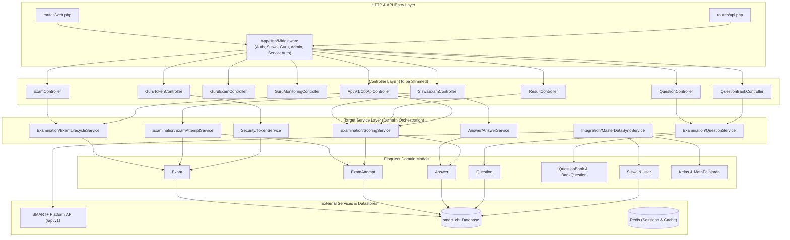

# CBT MODULE DEPENDENCY MAP & INTERACTION MATRIX
**Project:** SMART-CBT | **Date:** November 2026 | **Auditor & Lead Architect:** Principal Software Architect  

---

## 1. COMPONENT DEPENDENCY GRAPH

---

## 2. DATA FLOW & LIFECYCLE DEPENDENCIES

### 2.1 Student Examination Lifecycle
1. **Start Attempt:**
   - Dependent on: `User` -> `Siswa` (must be `status_aktif = true`) -> `Exam` (must be `status = 'aktif'`, `token_aktif = true`, `questions()->exists()`, date valid).
   - Generates: `ExamAttempt` (`status = 'in_progress'`, `started_at = now()`, `token_used`).
   - Session State: Verified attempt ID in session `siswa.exam_token_verified.{exam_id}`.
2. **Question Delivery:**
   - Dependent on: `ExamAttempt` (`status = 'in_progress'`), `Exam::questions`.
   - Sequencing: Shuffled by `question_order` array (deterministic per attempt).
3. **Autosave Persistence:**
   - Dependent on: `ExamAttempt` (`status = 'in_progress'`, `deadline > now() - 10m`).
   - Writes to: `answers` via atomic bulk upsert (`exam_attempt_id`, `question_id`, `jawaban`).
4. **Final Submission:**
   - Dependent on: `ExamAttempt` (`status = 'in_progress'`).
   - Writes to: `answers` (all answers synced), `exam_attempts` (`status = 'submitted'` or `'needs_grading'`, `submitted_at = now()`, `nilai_akhir`).

### 2.2 SMART+ Integration Contract
- **CBT Exposure:**
  - `GET /api/v1/exams`: Consumed by SMART+ `CbtIntegrationService::fetchAvailableExams`.
  - `GET /api/v1/exam-results`: Consumed by SMART+ `CbtIntegrationService::syncCbtViaApi`.
- **Contract Schema Requirements:**
  - Each item MUST contain: `id`, `attempt_external_id`, `exam_external_id`, `student_external_id`, `student_nisn`, `student_nis`, `score`, `status`, `started_at`, `submitted_at`.
  - Breaking any field in this response breaks the E-Rapor gradebook import on SMART+.
