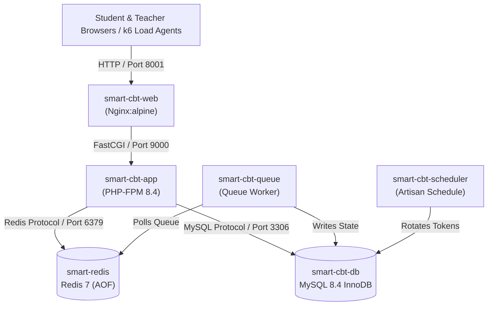

# SMART-CBT DOCKER DEPLOYMENT, OPERATIONAL RUNBOOK & DISASTER RECOVERY

**Project:** SMART-CBT Examination System  
**Environment:** Linux / Docker Compose Production Architecture  
**Author:** Principal Software Architect, DevOps & Database Reliability Engineer  
**Date:** November 12, 2026  

---

## 1. Production Architecture Overview

The SMART-CBT production environment is deployed as a coordinated set of Docker containers on a shared bridge network (`smart-network`):



---

## 2. Prerequisites & Host Sizing Guidelines

### Minimum Host Requirements (for 50–100 Concurrent Students):
- **CPU:** 4 vCPUs (x86_64 or ARM64)
- **RAM:** 8 GB RAM (minimum 4 GB free for containers)
- **Disk:** 40 GB NVMe / SSD storage with minimum 200 IOPS
- **OS:** Linux (Ubuntu 22.04 LTS / 24.04 LTS, Debian 12) or Windows 11 with Docker Desktop (WSL 2 backend)
- **Docker Engine:** Version 24.0+ (Docker Compose v2.20+)

---

## 3. Initial Build & Startup Procedure

### Step 1: Clone Repository & Configure Environment
```bash
git clone -b remediation/engineering-remediation <repository-url> smart-cbt
cd smart-cbt
cp .env.docker.example .env.docker
```

Generate secure credentials in `.env.docker`:
```ini
APP_KEY=base64:YOUR_GENERATED_APP_KEY
DB_DATABASE=smart_cbt
DB_USERNAME=smart_cbt
DB_PASSWORD=YOUR_STRONG_DB_PASSWORD
DB_ROOT_PASSWORD=YOUR_STRONG_ROOT_PASSWORD
CBT_WEB_PORT=8001
CBT_DB_PORT=3307
```

### Step 2: Build Images
```bash
docker compose --env-file .env.docker build
```

### Step 3: Launch Containers in Detached Mode
```bash
docker compose --env-file .env.docker up -d
```

### Step 4: Verify Container Health
```bash
docker compose ps
```
All containers (`smart-cbt-app`, `smart-cbt-web`, `smart-cbt-db`, `smart-redis`, `smart-cbt-queue`, `smart-cbt-scheduler`) should report `Up` with `(healthy)` status.

---

## 4. Database Migrations, Master Data & Optimization

### Run Database Migrations:
```bash
docker compose exec smart-cbt-app php artisan migrate --force
```

### Seed Master & Load Testing Data (If Initial Setup):
```bash
docker compose exec smart-cbt-app php artisan db:seed --class=MasterDataSeeder --force
docker compose exec smart-cbt-app php artisan db:seed --class=AdminSeeder --force
docker compose exec smart-cbt-app php artisan db:seed --class=GuruSeeder --force
docker compose exec smart-cbt-app php artisan db:seed --class=StudentSeeder --force
```

### Enable Production Optimization Caches:
```bash
docker compose exec smart-cbt-app php artisan optimize:clear
docker compose exec smart-cbt-app php artisan config:cache
docker compose exec smart-cbt-app php artisan route:cache
docker compose exec smart-cbt-app php artisan view:cache
docker compose exec smart-cbt-app php artisan event:cache
```

---

## 5. Daily Operations & Log Inspection

### Inspect Live Logs:
```bash
# All containers
docker compose logs -f --tail=100

# Web Nginx access and error logs
docker compose logs -f smart-cbt-web

# PHP-FPM application errors
docker compose logs -f smart-cbt-app

# Queue worker errors
docker compose logs -f smart-cbt-queue
```

### Inspect Laravel Application Log File:
```bash
docker compose exec smart-cbt-app tail -f storage/logs/laravel.log
```

---

## 6. Backup & Restoration Procedures

### 6.1 Database Backup (Hot Backup using mysqldump)
Run a transactionally consistent backup without locking tables:
```bash
docker compose exec smart-cbt-db mysqldump \
  -u root -p"smart_cbt_root_password" \
  --single-transaction \
  --quick \
  --routines \
  --triggers \
  smart_cbt > "smart_cbt_backup_$(date +%Y%m%d_%H%M%S).sql"
```

### 6.2 Database Restoration
To restore a snapshot in case of failure:
```bash
# Stop application traffic during restore
docker compose stop smart-cbt-web smart-cbt-app smart-cbt-queue

# Stream backup into database
docker compose exec -T smart-cbt-db mysql \
  -u root -p"smart_cbt_root_password" \
  smart_cbt < smart_cbt_backup_YYYYMMDD_HHMMSS.sql

# Restart application
docker compose start smart-cbt-app smart-cbt-queue smart-cbt-web
```

### 6.3 Redis Snapshot & AOF Persistence
Redis is configured with Append-Only File (`appendonly yes`). The data volume `smart-cbt-redis-data` persists across container restarts. To trigger an immediate Redis background save:
```bash
docker compose exec smart-redis redis-cli bgsave
```

---

## 7. Disaster Recovery & Infrastructure Failure Scenarios

### Scenario A: Database Unavailability (MySQL Down)
- **Impact:** Autosave and submission requests return HTTP 500 / 422.
- **Client Resilience:** The browser LocalStorage queue retains all unacknowledged student answers. Visual indicator shows "Gagal (retrying)".
- **Recovery:** Start MySQL container (`docker compose up -d smart-cbt-db`). Once MySQL is healthy, student browsers automatically retry and sync queued answers without answer loss.

### Scenario B: Redis Cache / Session Outage
- **Impact:** Active user sessions become unreachable; background queues stall.
- **Recovery:** Restart Redis (`docker compose restart smart-redis`). Because Redis AOF is enabled, persistent keys and sessions are restored from the `/data` volume.

### Scenario C: PHP-FPM Container Restart
- **Impact:** In-flight HTTP requests (~1–2 seconds) receive a momentary 502 Bad Gateway from Nginx.
- **Client Resilience:** Nginx reconnects as soon as PHP-FPM boots. Client autosave retry mechanism re-transmits any failed batch.

### Scenario D: Rollback and Forward-Fix Policy
- **Strict Rule:** Never delete student exam attempts (`exam_attempts`) or historical answers to revert migrations.
- **Forward-Fix:** Apply non-destructive additive migrations (`ADD COLUMN ...`, `ADD INDEX ...`). If an index causes slow writes, drop the index via a forward-fix migration.
