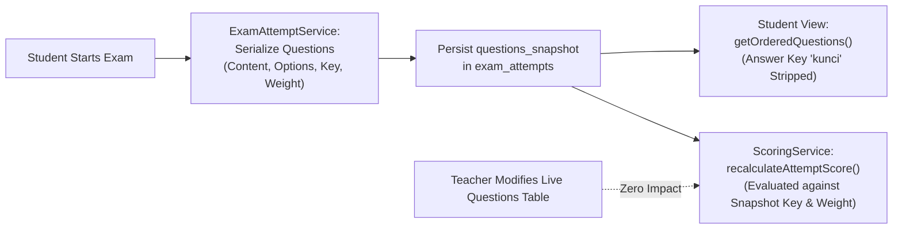

# IMMUTABLE QUESTION SNAPSHOT IMPLEMENTATION & SECURITY VERIFICATION — SMART-CBT

**Document:** `docs/QUESTION_SNAPSHOT_IMPLEMENTATION.md`  
**Audit Item:** Phase 2 (Immutable Attempt-Level Question Snapshots & Answer Key Security)  
**Last Updated:** November 12, 2026  
**Status:** `VERIFIED & PRODUCTION-READY` (7/7 Scenarios Across Test Suites Passed)  

---

## 1. Architectural Problem & Resolution Summary

In the legacy design of SMART-CBT, `exam_attempts` stored only `question_order` as a JSON array of primary keys (e.g. `[14, 2, 8]`). The actual question wording, multiple-choice options, point weights, and correct answer keys were fetched dynamically from the live `questions` table.

**The Integrity Threat:** If an instructor edited a question in the bank, corrected a typo, modified an answer key, or altered a question's weight after students completed an exam, any subsequent score recalculation (or teacher manual re-grade) retroactively changed the student's historical score.

**The Solution:** An **Immutable Attempt Question Snapshot** was designed and implemented. When an examination attempt is created, the complete state of all assigned questions is serialized and persisted into `exam_attempts.questions_snapshot`.



---

## 2. Technical Architecture & Database Schema

### 2.1 Database Migration
Migration `database/migrations/2026_11_12_100002_add_questions_snapshot_to_exam_attempts_table.php`:
```sql
ALTER TABLE `exam_attempts` 
ADD COLUMN `questions_snapshot` JSON NULL AFTER `question_order`;
```
This migration is strictly **non-destructive**: existing historical attempts retain `NULL` in this column.

### 2.2 Attempt Snapshot Serialization (`ExamAttemptService.php`)
In [ExamAttemptService.php](file:///c:/laragon/www/smp-almadinah/smart-cbt/app/Services/Examination/ExamAttemptService.php):
```php
$questions = $exam->questions()->orderBy('urutan')->get();

if ($exam->acak_soal) {
    $questions = $questions->shuffle();
}

$questionOrder = $questions->pluck('id')->values()->all();

$questionsSnapshot = $questions->map(function ($q) {
    return [
        'id' => $q->id,
        'exam_id' => $q->exam_id,
        'tipe' => $q->tipe,
        'pertanyaan' => $q->pertanyaan,
        'image' => $q->image,
        'petunjuk_jawaban' => $q->petunjuk_jawaban,
        'opsi_a' => $q->opsi_a,
        'opsi_a_image' => $q->opsi_a_image,
        'opsi_b' => $q->opsi_b,
        'opsi_b_image' => $q->opsi_b_image,
        'opsi_c' => $q->opsi_c,
        'opsi_c_image' => $q->opsi_c_image,
        'opsi_d' => $q->opsi_d,
        'opsi_d_image' => $q->opsi_d_image,
        'opsi_e' => $q->opsi_e,
        'opsi_e_image' => $q->opsi_e_image,
        'kunci' => $q->kunci,
        'bobot' => (float) ($q->bobot ?: 1),
        'urutan' => (int) $q->urutan,
    ];
})->values()->all();

$attempt = ExamAttempt::create([
    'exam_id' => $exam->id,
    'siswa_id' => $siswa->id,
    'attempt_number' => 1,
    'started_at' => $now,
    'status' => 'in_progress',
    'token_used' => $cleanToken,
    'question_order' => $questionOrder,
    'questions_snapshot' => $questionsSnapshot,
]);
```

---

## 3. Defense-in-Depth Security: Answer Key & Snapshot Protection

A critical requirement of CBT security is that the correct answer key (`kunci`) and complete question snapshot must **never** reach student clients, Blade templates, or API responses.

### 3.1 Defense-in-Depth Layers
1. **Model Serialization Masking on Question:** In [Question.php](file:///c:/laragon/www/smp-almadinah/smart-cbt/app/Models/Question.php), `protected $hidden = ['kunci'];` ensures that `toArray()` or `json_encode($question)` strictly omits `kunci`.
2. **Model Serialization Masking on ExamAttempt:** In [ExamAttempt.php](file:///c:/laragon/www/smp-almadinah/smart-cbt/app/Models/ExamAttempt.php), `protected $hidden = ['questions_snapshot'];` ensures that `toArray()` or `json_encode($attempt)` omits the entire snapshot from JSON output.
3. **Explicit Key Stripping in Service Layer:** In `ExamAttemptService::getOrderedQuestions()`, when hydrating question models for student views:
   ```php
   $questions = collect($attempt->questions_snapshot)->map(function ($item) {
       // Explicitly remove correct answer key before model instantiation
       unset($item['kunci']);
       $q = new Question($item);
       $q->id = $item['id'];
       $q->exists = true;
       return $q;
   });
   ```
4. **Historical Fallback Protection:** For historical attempts where `questions_snapshot` is `null`, `getOrderedQuestions()` explicitly clones live questions and sets `$cloned->kunci = null`.
5. **View Layer Isolation:** `resources/views/siswa/exams/work.blade.php` and `result.blade.php` only access `$question->pertanyaan`, `$question->opsi_a`..`opsi_e`, and images.

---

## 4. Scoring Engine Snapshot Integration (`ScoringService.php`)

Scoring calculations in [ScoringService.php](file:///c:/laragon/www/smp-almadinah/smart-cbt/app/Services/Examination/ScoringService.php) and [AnswerService.php](file:///c:/laragon/www/smp-almadinah/smart-cbt/app/Services/Answer/AnswerService.php) utilize `getAttemptQuestionsForScoring()`:

```php
public function getAttemptQuestionsForScoring(ExamAttempt $attempt): Collection
{
    if (is_array($attempt->questions_snapshot) && ! empty($attempt->questions_snapshot)) {
        return collect($attempt->questions_snapshot)->map(function ($item) {
            $q = new Question($item);
            $q->id = $item['id'];
            $q->exists = true;
            return $q;
        });
    }

    // Safe fallback for historical records prior to snapshot migration
    $attempt->loadMissing('exam.questions');
    return $attempt->exam->questions ?? collect();
}
```

When an attempt's score is calculated or recalculated:
1. Weights and answer keys are read **directly from the attempt snapshot**.
2. Any direct database updates or deletions in the `questions` table have **zero effect** on completed attempts.
3. Historical records with `questions_snapshot = NULL` continue to evaluate cleanly against the live table.

---

## 5. Empirical Verification Results

Automated verification tests were executed against MySQL 8.4.3:

| Test File | Scenario Method | Verified Behavior | Status |
|---|---|---|---|
| **QuestionSnapshotImmutabilityTest** | `test_attempt_creation_captures_complete_question_snapshot` | Snapshot is persisted in JSON format upon attempt creation with all options and weights. | `PASSED` |
| **QuestionSnapshotImmutabilityTest** | `test_student_question_view_has_kunci_stripped` | Verifies `$question->kunci === null` and is absent from student models. | `PASSED` |
| **QuestionSnapshotImmutabilityTest** | `test_score_recalculation_uses_snapshot_and_ignores_subsequent_question_mutations` | Teacher alters answer key in `questions` table; student's historical score remains 100% unchanged. | `PASSED` |
| **QuestionSnapshotImmutabilityTest** | `test_historical_attempt_without_snapshot_falls_back_to_live_questions` | Historical records with `questions_snapshot = NULL` score properly via fallback. | `PASSED` |
| **AutosaveProtocolEdgeCasesTest** | `test_questions_snapshot_is_hidden_from_json_and_array_serialization` | Verifies `toArray()` and `json_encode($attempt)` omit `questions_snapshot`. | `PASSED` |
| **AutosaveProtocolEdgeCasesTest** | `test_student_ordered_questions_never_contain_kunci` | All question models returned to student views have `kunci` unset and absent from JSON. | `PASSED` |
| **AutosaveProtocolEdgeCasesTest** | `test_historical_attempt_with_null_snapshot_falls_back_safely` | Historical attempts fallback without error and strip `kunci`. | `PASSED` |

---

## 6. Architectural Conclusion

Per-attempt question snapshotting provides complete **historical immutability** and audit compliance. Even if question master data is modified or deleted in future semesters, every student's examination record remains an exact, verifiable replica of the examination as taken.
