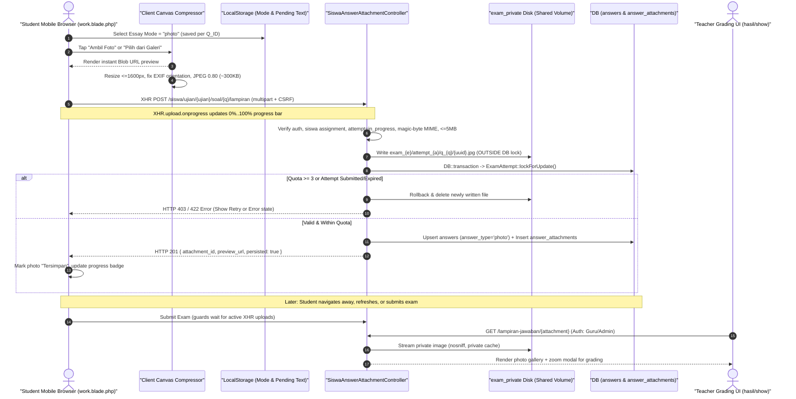
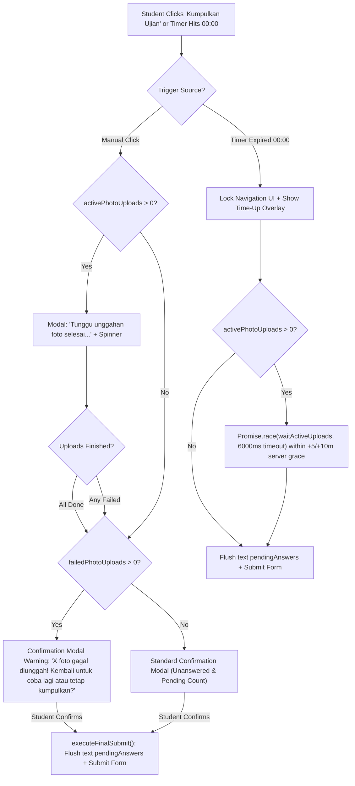
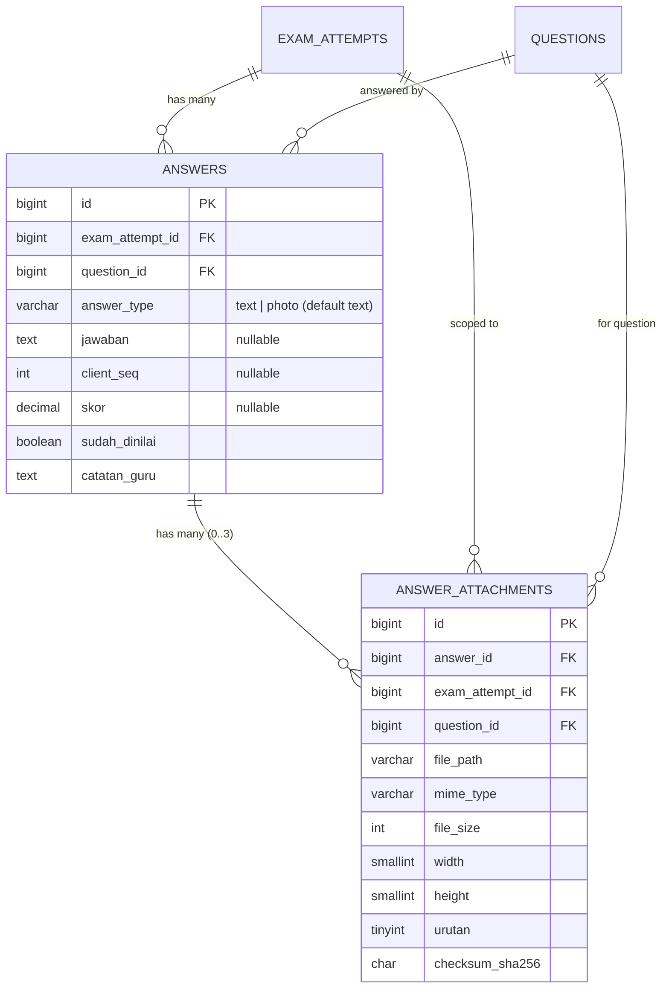

# SMART-CBT — Technical Audit: Photo-Based Essay Answers Feature

**Document Type:** Architecture, Feasibility, Security, Reliability & Performance Audit  
**Project:** SMART-CBT (Integrated with SMART+ Student Management Platform)  
**Target Feature:** Photo-Based Essay Answers (Text / Photo Dual-Mode per Question)  
**Audit Date:** November 19, 2026  
**Audit Mode:** **AUDIT ONLY** (No source code modified, no migrations created/executed, no packages installed)

---

## 0. Executive Summary & Verified Discrepancies

### 0.1 Executive Summary

The existing SMART-CBT examination engine is built on **Laravel 13 (`^13.17`) / PHP 8.3+ (`8.4.27-fpm` in Docker)** with **Alpine.js (`^3.4.2`)** and **Tailwind CSS** on the frontend, running in production behind **Nginx**, **3 load-balanced PHP-FPM replicas**, **Redis 7** (sessions, cache, queues), and **PostgreSQL 16** (Docker) / **MySQL** (local `.env`).

Currently, Essay questions only render a plain `<textarea>` inside `resources/views/siswa/exams/work.blade.php` and store scalar text inside `answers.jawaban` (`TEXT NULL`), protected by a monotonic `client_seq` delta autosave engine and pessimistic `ExamAttempt::lockForUpdate()` transactions. **No student-side file upload, camera capture, attachment model, private storage route, or photo grading UI currently exists.**

Extending Essay questions to support **Text Answer** and **Photo Answer** independently per question is **technically feasible without redesigning the existing autosave or scoring core**, provided that:
1. **Binary photo uploads are strictly decoupled** from the JSON delta autosave channel (`POST /siswa/ujian/{ujian}/jawaban`) and final form submission (`POST /siswa/ujian/{ujian}/kumpulkan`).
2. **Client-side HTML5 Canvas image compression** (`max 1600px`, JPEG `0.80` quality -> `~200–400 KB`) is applied prior to upload to protect PHP-FPM workers and campus Wi-Fi bandwidth.
3. **Private authenticated storage** (`storage/app/private`) is used via a dedicated shared Docker volume across all PHP-FPM replicas, rather than the unauthenticated `/storage/` public symlink.
4. Existing latent bugs and documentation discrepancies discovered during this audit are remediated prior to or alongside Stage 1 of implementation.

---

### 0.2 Documentation vs. Implementation Discrepancies & Latent Bugs Found

Per strict engineering audit verification against live source files, the following **5 concrete discrepancies** exist in the current repository:

| # | Area | Documented Claim / Assumption | Actual Verified Implementation | Impact on Essay Photo Feature |
|---|---|---|---|---|
| **1** | **Autosave Protocol** | `AUDIT_FINAL_LOCALSTORAGE.md` describes a 5-question batch threshold (`CONFIG.BATCH_SIZE = 5`) sending via `Answer::updateOrCreate()`. | `resources/views/siswa/exams/work.blade.php` (lines 438–961) and `app/Services/Answer/AnswerService.php` implement a **Delta Autosave Engine** (`flushPendingDelta()`) with `DEBOUNCE_DELAY: 500`, `AUTOSAVE_INTERVAL: 10000` (±20% jitter), `MAX_RETRIES: 4`, Redis `request_id` idempotency (`cbt:idempotency:{attempt_id}:{request_id}`), monotonic `client_seq`, and sorted `Answer::upsert()`. *(An unused legacy view `resources/views/siswa/exams/work_new.blade.php` still contains the old `BATCH_SIZE: 5` script).* | New photo status sync must integrate with the active **delta + `client_seq`** state machine in `work.blade.php`, not the obsolete `BATCH_SIZE = 5` model. |
| **2** | **Latent Frontend Resume Bug** | `AUDIT_FINAL_LOCALSTORAGE.md` and `docs/AUTOSAVE_SEQUENCE_VERIFICATION.md` state resume merges DB + `localStorage` cleanly. | In `resources/views/siswa/exams/work.blade.php`, `state` (lines 455–470) does **not** define `changedQuestions`, yet `initialize()` (lines 1243–1245) executes `state.changedQuestions.add(qId)` whenever `localStorage` has pending answers on page reload. | **CRITICAL:** When a student refreshes or browser memory reloads with pending `localStorage` entries, `initialize()` throws `TypeError: Cannot read properties of undefined (reading 'add')` before event listeners and the countdown timer attach. |
| **3** | **Essay `tipe` Grading Mismatch** | `docs/production-readiness/ESSAY_SCORING_VERIFICATION.md` cites `AnswerService::gradeEssayBatch()` and `EssayGradingWorkflowTest.php`, assuming `tipe === 'essay'`. | `QuestionController::validated()` (line 313) & `QuestionBankController::storeQuestion()` (line 121) only permit `'in:pg,essay_1,essay_2'`. However, `ResultController::gradeEssay()` (line 136) enforces `abort_unless($answer->question->tipe === 'essay', 422)`. Meanwhile, `ScoringService` and `AnswerService` treat any `$question->tipe !== 'pg'` as Essay. *(Existing `EssayGradingTest.php` line 56 bypassed UI validation by seeding `'tipe' => 'essay'` directly).* | **HIGH:** Teachers grading Essay answers (`essay_1` / `essay_2`) created via the UI receive HTTP `422` (`Pertanyaan ini bukan bertipe essay.`). Must be fixed to `$answer->question->tipe !== 'pg'` before grading photo essays. |
| **4** | **`pagehide` Unsequenced Payload & `exam:force-close` Bypass** | `docs/AUTOSAVE_SEQUENCE_VERIFICATION.md` guarantees sequence recovery and `ScoringService` scoring. | In `work.blade.php` (lines 1148–1157), `pagehide` sends `{ answers }` **without `client_seqs`** and **without `keepalive: true`**, which fails `AnswerService` downgrade protection (`client_seq !== null` in DB vs `null` incoming). Additionally, `routes/console.php` `exam:force-close` (lines 72–118) closes expired attempts directly without calling `AnswerService::submitAttemptAnswers()` or setting `needs_grading` for essays. | Must ensure photo answer states are not corrupted by unsequenced `pagehide` requests and that `exam:force-close` delegates to `AnswerService::submitAttemptAnswers()`. |
| **5** | **Docker Private Volume & FPM Pool Config** | `config/filesystems.php` defines `'local'` disk at `storage_path('app/private')`; `docs/production/PHP_FPM_CAPACITY_ANALYSIS.md` specifies `pm = static` (50 workers, `listen.backlog = 1024`). | `docker-compose.yml` (lines 14, 63, 114, 204, 221, 270) mounts `smart-cbt-storage` **only** to `/var/www/html/storage/app/public`. `/var/www/html/storage/app/private` is ephemeral per container! Also, `docker/php/www.conf` (lines 10–15) still uses `pm = dynamic` (`start_servers = 10`, `max_children = 50`), and `.env` uses `mysql` while `docker-compose.yml` uses `pgsql`. | Storing private student answer photos on `/var/www/html/storage/app/private` without mounting a shared volume across all 3 PHP-FPM replicas will cause **HTTP 404 errors** across round-robin requests. |

---

## 1. Phase 1 & Deliverable A — Current Architecture Audit

### 1.1 Relevant Files & Classes

#### Models (`app/Models/`)
- **`app/Models/Exam.php`**: Defines exam metadata (`guru_id`, `guru_pengawas_id`, `mata_pelajaran_id`, `nama`, `jenis`, `kelas_id`, `durasi_menit`, `komponen_soal` cast to `array`, `acak_soal`, `status`, `token`, `token_aktif`, `token_kedaluwarsa_at`). Relations: `questions()`, `examAttempts()`, `guru()`, `guruPengawas()`, `mataPelajaran()`, `kelasData()`, `supervisors()`.
- **`app/Models/Question.php`**: Defines exam questions (`exam_id`, `tipe`, `pertanyaan`, `image`, `petunjuk_jawaban`, `opsi_a`..`opsi_e`, `opsi_a_image`..`opsi_e_image`, `kunci`, `bobot`, `urutan`).
  - Hides `kunci` via `protected $hidden = ['kunci'];` (lines 36–38).
  - Booted guards (lines 40–53) throw `\DomainException` on `updating` or `deleting` if `$question->exam->examAttempts()->exists()`.
  - Relations: `exam()`, `answers()`.
- **`app/Models/BankQuestion.php` & `app/Models/QuestionBank.php`**: Reusable question bank templates sharing identical question columns (except `urutan` and `exam_id`).
- **`app/Models/ExamAttempt.php`**: Tracks a student's exam session (`exam_id`, `siswa_id`, `started_at`, `submitted_at`, `status`, `nilai_akhir`, `nilai_pg`, `nilai_essay`, `attempt_number`, `token_used`, `question_order` JSON, `questions_snapshot` JSON).
  - Hides `questions_snapshot` via `protected $hidden = ['questions_snapshot'];` (lines 41–43).
  - Relations: `exam()`, `siswa()`, `answers()`.
- **`app/Models/Answer.php`**: Stores a student's answer per question (`exam_attempt_id`, `question_id`, `jawaban`, `client_seq`, `is_correct`, `skor`, `sudah_dinilai`, `catatan_guru`).
  - Relations: `examAttempt()`, `question()`.
  - **Verification:** Neither `Answer` nor `ExamAttempt` currently has any `answer_type` attribute or attachment relationship (`attachments()`).
- **`app/Models/Siswa.php`**, **`app/Models/Guru.php`**, **`app/Models/User.php`**: Role-based identity models linked via `users.role` (`admin`, `guru`, `siswa`).

#### Services (`app/Services/`)
- **`app/Services/Examination/ExamAttemptService.php`**:
  - `startOrResumeAttempt()` (lines 21–116): Validates class assignment (`ensureAssigned`), schedule, active status, and `hash_equals` token check; creates or resumes `ExamAttempt` (`attempt_number = 1`) inside `DB::transaction` with up to 5 deadlock/race retries; snapshots all question attributes (including `kunci` and `bobot`) into `questions_snapshot` and `question_order`.
  - `getOrderedQuestions()` (lines 122–164): Hydrates `Question` models from `questions_snapshot` (explicitly `unset($item['kunci'])`), sorted by `question_order`.
  - `calculateDeadline()` (lines 199–208): `min(started_at + durasi_menit, tanggal_selesai)`.
- **`app/Services/Answer/AnswerService.php`**:
  - `saveBatchAnswers()` (lines 31–227): Handles delta autosaves with Redis/Cache fast-path idempotency, pessimistic `ExamAttempt::lockForUpdate()`, deadline + 10 min tolerance, snapshot-aware `validQuestionIds`, monotonic `client_seq` validation (`0..4294967295`), downgrade protection, sorted `Answer::upsert()`, and structured `{acknowledged, rejected}` response.
  - `submitAttemptAnswers()` (lines 234–315): Locks `ExamAttempt`, merges DB answers with submitted form answers, evaluates PG via `ScoringService`, initializes/updates Essay answer rows (`sudah_dinilai` preserved), sets status (`needs_grading` if `$hasEssayQuestions`, else `expired` or `submitted`), and calls `ScoringService::recalculateAttemptScore()`.
- **`app/Services/Examination/ScoringService.php`**:
  - `evaluatePgQuestion()` (lines 19–36): Case-insensitive `hash_equals` comparison against `kunci` weighted by `bobot`.
  - `gradeEssayAnswer()` (lines 42–66): Clamps score `[0.0, maxWeight]` against `questions_snapshot` (or live `question->bobot`), updates `skor`, `is_correct = $clampedScore > 0`, `sudah_dinilai = true`, `catatan_guru`.
  - `recalculateAttemptScore()` (lines 72–132): Locks `ExamAttempt`, sums PG and graded Essay points using snapshot weights, normalizes `nilai_akhir = round(($totalEarned / $totalWeight) * 100, 2)`, transitions `needs_grading` $\to$ `completed` once no ungraded essays remain.

#### Controllers (`app/Http/Controllers/`)
- **`app/Http/Controllers/SiswaExamController.php`**: Student exam lifecycle (`dashboard`, `index`, `history`, `results`, `show`, `token`, `start`, `work`, `saveAnswers`, `leave`, `submit`, `result`).
- **`app/Http/Controllers/ResultController.php`**: Teacher/Admin grading and result inspection (`index`, `show`, `gradeEssay`).
- **`app/Http/Controllers/QuestionController.php`** & **`QuestionBankController.php`**: Question CRUD and Excel import/export. Both handle image uploads to `public` disk (`questions` and `questions/options`).
- **`app/Http/Controllers/ExportController.php`**: FastExcel `.xlsx` exports (`exportSoalUjian`, `exportBankSoal`, `exportHasilKelas`, `exportHasilFilter`, `exportHasilSiswa`, `exportRekapJawaban`).
- **`app/Http/Controllers/ExamCardController.php`**: PDF generation (`barryvdh/laravel-dompdf`) and image uploads (`exam-cards` on `public` disk).
- **`app/Http/Controllers/Api/V1/CbtApiController.php`**: Read-only external integration endpoints (`getExams`, `getExamAttempts`, `getExamResults`) for SMART+ E-Rapor, gated by `ServiceAuthMiddleware`.

---

### 1.2 Database Tables & Relationships

Key tables verified from `database/migrations/`:

| Table | Source Migration(s) | Key Columns & Constraints | Relevance to Feature |
|---|---|---|---|
| **`exams`** | `2026_08_23_053501`, `060000`, `061000`, `070000`, `071000`, `2026_08_27`, `2026_09_01`, `09_06`, `09_22`, `2026_11_12_000001`, `000003` | `id`, `guru_id` (`restrictOnDelete`), `guru_pengawas_id`, `mata_pelajaran_id`, `kelas_id`, `jenis`, `komponen_soal` (JSON), `durasi_menit`, `tanggal_mulai`, `tanggal_selesai`, `status` | Composite indexes on `(kelas_id, status, tanggal_mulai)`. |
| **`questions`** | `2026_08_23_053542`, `2026_08_24_080001`, `080002`, `2026_09_24_210943`, `2026_09_29_191000` | `id`, `exam_id` (`cascadeOnDelete`), `tipe` (`pg`, `essay_1`, `essay_2`), `urutan`, `pertanyaan` (`TEXT`), `image`, `petunjuk_jawaban` (`TEXT`), `opsi_a..e`, `opsi_a..e_image`, `kunci`, `bobot` (`DECIMAL(5,2)`), `UNIQUE(exam_id, urutan)` | Essay questions are distinguished only by `tipe` (`essay_1`, `essay_2`, or legacy `essay`). No per-question answer-mode toggle exists. |
| **`exam_attempts`** | `2026_08_23_053604`, `2026_08_30_000000`, `2026_11_12_000001`, `000002`, `000003`, `100002` | `id`, `exam_id` (`cascadeOnDelete`), `siswa_id` (`cascadeOnDelete`), `started_at`, `submitted_at`, `status` (`in_progress`, `submitted`, `expired`, `needs_grading`, `completed`), `nilai_akhir`, `nilai_pg`, `nilai_essay`, `attempt_number`, `question_order` (JSON), `questions_snapshot` (JSON), `UNIQUE(exam_id, siswa_id, attempt_number)` | Central session lock target (`lockForUpdate()`) for autosave and submission. |
| **`answers`** | `2026_08_23_053624`, `2026_11_12_000001`, `2026_11_12_100001` | `id`, `exam_attempt_id` (`cascadeOnDelete`), `question_id` (`restrictOnDelete`), `jawaban` (`TEXT NULL`), `client_seq` (`INT UNSIGNED NULL`), `is_correct` (`BOOLEAN NULL`), `skor` (`DECIMAL(5,2) NULL`), `sudah_dinilai` (`BOOLEAN DEFAULT 0`), `catatan_guru` (`TEXT NULL`), `UNIQUE(exam_attempt_id, question_id)` | 1:1 row per `(exam_attempt_id, question_id)`. Cannot store multiple photo paths cleanly without violating 1NF or risking text overwrite. |

**Existing Relationships:**
- `Siswa` `1..N` `ExamAttempt` `1..N` `Answer` `N..1` `Question`
- `Exam` `1..N` `Question`, `Exam` `1..N` `ExamAttempt`
- **Attachment Relationships:** None exist anywhere in the codebase.

---

### 1.3 Web & API Routes

Verified in `routes/web.php`, `routes/api.php`, and `app/Providers/AppServiceProvider.php`:

| Route Name | Method & URI | Middleware / Rate Limiter | Controller Action |
|---|---|---|---|
| `siswa.ujian.start` | `POST /siswa/ujian/{ujian}/mulai` | `auth`, `siswa`, `throttle:exam-start` (60/min by user/session) | `SiswaExamController@start` |
| `siswa.ujian.work` | `GET /siswa/ujian/{ujian}/kerjakan` | `auth`, `siswa` (+ session token check) | `SiswaExamController@work` |
| `siswa.ujian.answers` | `POST /siswa/ujian/{ujian}/jawaban` | `auth`, `siswa`, `throttle:exam-autosave` (300/min by user/session) | `SiswaExamController@saveAnswers` |
| `siswa.ujian.leave` | `POST /siswa/ujian/{ujian}/keluar` | `auth`, `siswa` | `SiswaExamController@leave` |
| `siswa.ujian.submit` | `POST /siswa/ujian/{ujian}/kumpulkan` | `auth`, `siswa`, `throttle:exam-submit` (30/min by user/session) | `SiswaExamController@submit` |
| `siswa.ujian.result` | `GET /siswa/ujian/{ujian}/hasil` | `auth`, `siswa` | `SiswaExamController@result` |
| `hasil.show` / `guru.hasil.show` | `GET /hasil-ujian/{attempt}` / `/guru/hasil-ujian/{attempt}` | `auth`, `admin` or `guru` | `ResultController@show` |
| `hasil.grade-essay` / `guru.hasil.grade-essay` | `POST /hasil-ujian/{attempt}/nilai-essay` / `/guru/...` | `auth`, `admin` or `guru` | `ResultController@gradeEssay` |

*(External SMART+ API routes in `routes/api.php` only expose exam metadata, attempts, and finalized aggregate scores — not individual answer payloads).*

---

### 1.4 Frontend Architecture & Autosave Workflow

The live student examination interface is `resources/views/siswa/exams/work.blade.php` (1,479 lines).

1. **Question Rendering & Navigation**:
   - All ordered questions from `ExamAttemptService::getOrderedQuestions()` are rendered in the DOM as `.question-panel` `<section>` blocks (lines 216–301), toggled via `style="display: block|none"` by `showQuestion(number)` (lines 967–995).
   - Navigation uses `#previous`, `#next`, `#finish` buttons plus a desktop sticky sidebar (`.question-number` buttons) and an Alpine.js mobile slide-over drawer (`navOpen`).
   - Mobile responsiveness includes sticky header status bar, MathJax 2.7.7 overflow wrappers, `min-h-[44px]` touch buttons, and an Alpine `zoomImage` full-screen lightbox (lines 1463–1474).
   - **Important WebView Compatibility Note:** Code comments on lines 1002 and 1430 explicitly note compatibility requirements with **Safe Exam Browser** and **Android Exambro** (e.g., custom Alpine modals instead of native `window.confirm`/`alert` blocking).
2. **Essay UI**:
   - Currently rendered at lines 290–299 as a single `<textarea name="answers[{{ $question->id }}]" rows="5" class="... answer-input ..." data-question-id="{{ $question->id }}">`.
3. **Autosave Lifecycle (`work.blade.php` lines 438–961 & 1136–1340)**:
   - **Events:** Every `.answer-input` binds `input` and `change` listeners (lines 1284–1317) calling `trackAnswerChange(questionId, currentValue)` and `queueSave()`.
   - **Sequence & LocalStorage Queue:** `trackAnswerChange()` increments `state.questionSequences[qId]`, updates `state.pendingAnswers` & `state.pendingSeqs`, and writes immediately to `localStorage` keys `cbt_pending_answers_{ATTEMPT_ID}` and `cbt_question_seqs_{ATTEMPT_ID}`.
   - **Dual Triggers:**
     1. **Debounced Trigger:** `queueSave()` fires `flushPendingDelta()` after `500ms` of inactivity (`CONFIG.DEBOUNCE_DELAY`).
     2. **Jittered Periodic Trigger:** `scheduleNextPeriodicSave()` runs every `8s–12s` (`10000ms ± 20%`).
     3. **Visibility Trigger:** `visibilitychange` (`hidden` uses `useKeepalive: true`; `visible` flushes pending answers).
   - **Navigation Interaction:** Switching questions (`showQuestion()`) does **not** trigger an immediate HTTP flush and does **not** unmount DOM panels; all panels remain mounted in the DOM, preserving inputs while the 500ms debounce/10s timer syncs in the background.
   - **Idempotency & ACK Verification:** `flushPendingDelta()` generates `request_id = req_{ts}_{rand}` and retries up to 4 times (`MAX_RETRIES: 4`, exponential backoff `1s, 2s, 4s, 8s` + random 0–500ms jitter) reusing the **same `request_id`**. On HTTP 200 `{ saved: true, acknowledged, rejected }`, pending entries are deleted from memory and `localStorage` **only if** `state.pendingSeqs[qId] === sentSeqs[qId]` (protecting newer edits made while the request was in flight).
   - **Resume After Refresh:** `SiswaExamController@work` injects `$answers` into the Blade inputs and `$answerSeqs` into `SERVER_SEQS`. `initialize()` reconciles `Math.max(serverSeq, localSeq)` and discards stale local entries where `localSeq < serverSeq` *(subject to the latent `state.changedQuestions` bug noted in Section 0.2)*.

---

### 1.5 Submission & Timer Expiration Workflow

1. **Manual Submit (`submitExam()` -> `executeFinalSubmit()`, lines 1004–1085)**:
   - Opens Alpine confirmation modal (`showConfirmModal`) showing `unansweredCount` (computed from `getCurrentAnswers()` via `FormData`) and `pendingCount`.
   - On confirmation: acquires `state.submitStarted = true`, `state.isSubmitting = true`, syncs `state.pendingAnswers` back into DOM inputs, awaits `saveAllPendingAnswers()` (`flushPendingDelta()`), clears `localStorage` only after server ACK, and invokes `elements.form.submit()` (`POST /siswa/ujian/{ujian}/kumpulkan`).
   - If `saveAllPendingAnswers()` fails after retries, submission aborts, buttons re-enable, and an error modal displays (`submitErrorMessage`) preserving `localStorage`.
2. **Client Timer Expiration (`timeExpired()`, lines 1090–1127)**:
   - Countdown `setInterval` checks `deadline - Date.now()` (`deadline = min(started_at + durasi_menit, tanggal_selesai)`).
   - At `00:00`: locks UI with full-screen overlay, disables navigation buttons (keeps form inputs enabled so `form.submit()` includes values), awaits `saveAllPendingAnswers()`, clears `localStorage`, waits `1000ms`, and calls `elements.form.submit()`.
3. **Server-Side Locking & Deadlines**:
   - `AnswerService::submitAttemptAnswers()` acquires `ExamAttempt::whereKey($attempt->id)->lockForUpdate()`.
   - If `$lockedAttempt->status !== 'in_progress'`, returns idempotently without modifying answers.
   - Once `status` becomes `'submitted'`, `'expired'`, or `'needs_grading'`, `SiswaExamController@work`, `@saveAnswers`, and `@submit` all reject further access (`abort_unless($attempt?->status === 'in_progress', 403)`), and `AnswerService::saveBatchAnswers()` throws `InvalidArgumentException` (`403`).
   - **Grace Window Discrepancy:** `SiswaExamController@work` auto-submits at `deadline + 5 min`; `AnswerService::saveBatchAnswers()` accepts saves until `deadline + 10 min`; `SiswaExamController@show` auto-submits immediately at `deadline`.

---

### 1.6 File Storage Architecture

| Parameter | Verified Current Configuration |
|---|---|
| **Filesystem Config (`config/filesystems.php`)** | `'default' => env('FILESYSTEM_DISK', 'local')`; `'local'` root = `storage_path('app/private')` (`serve => true`); `'public'` root = `storage_path('app/public')`, symlinked to `public/storage`. |
| **Environment Values** | `.env`: `FILESYSTEM_DISK=local`; `.env.docker.example`: `FILESYSTEM_DISK=public`. |
| **Existing Upload Usage** | `QuestionController`, `QuestionBankController`, and `ExamCardController` explicitly pass `'public'` disk (`->store('questions', 'public')`, `->store('questions/options', 'public')`, `->store('exam-cards', 'public')`). |
| **Allowed MIME & Size Limits (App)** | Question/option images: `['nullable', 'image', 'mimes:jpg,jpeg,png,webp,gif,svg', 'max:2048']` (2 MB). Exam cards: `'nullable|image|max:2048'`. |
| **Web Server & PHP Limits** | Nginx (`docker/nginx/default.conf` line 17): `client_max_body_size 64M;`. PHP (`docker/php/php.ini`): `upload_max_filesize = 64M`, `post_max_size = 64M`, `memory_limit = 512M`, `max_execution_time = 300`. |
| **Public Accessibility** | Nginx (`docker/nginx/default.conf` lines 40–46) serves `/storage/*` directly from `/var/www/html/storage/app/public/` with **zero authentication** and 1-year `public, immutable` cache headers. |
| **Cleanup Mechanisms** | Only explicit deletion in `QuestionController@update/@destroy`, `QuestionBankController@destroyQuestion`, and `ExamCardController@settings` via `Storage::disk('public')->delete(...)`. No scheduled orphan cleanup exists. |
| **Installed Image Libraries** | PHP `gd` (with JPEG & FreeType) and `exif` extensions are compiled in `Dockerfile` (lines 60–70). No third-party Composer image package (e.g., Intervention Image) is installed. |

**Security Finding:** Storing student essay answer photos on the `'public'` disk is **unsuitable and insecure**. Any student or unauthenticated user could enumerate or view another student's answer sheet directly via `/storage/...` bypassed past PHP/Laravel authorization.

---

## 2. Deliverable B — Feature Gap Analysis

| Feature | Current Implementation | Required Modification |
|---|---|---|
| **Text Answer** | Rendered as `<textarea name="answers[{{ $question->id }}]">` in `resources/views/siswa/exams/work.blade.php` (lines 291–298). Saved to `answers.jawaban` via `AnswerService::saveBatchAnswers()`. | Preserve existing `<textarea>` behavior completely. Add `answers.answer_type` (`DEFAULT 'text'`) so existing and text-based essays remain 100% compatible without data migration. |
| **Photo Answer** | **Does not exist.** No UI mode toggle, no photo answer type, and `answers` only stores scalar `jawaban` string. | Add per-question answer mode selector (`text` vs `photo`) in `work.blade.php`, persist `answer_type` in `answers`, and render uploaded photo cards + grading gallery in `hasil/show.blade.php`. |
| **Camera Capture** | **Does not exist.** No `<input type="file">` exists in `work.blade.php` (only in teacher `guru/soal/form.blade.php`). | Add dedicated `<input type="file" accept="image/jpeg,image/png,image/webp" capture="environment">` triggered by an explicit **"Ambil Foto (Kamera)"** button, falling back gracefully if camera hardware/permission is unavailable. |
| **Gallery Upload** | **Does not exist.** | Add a second dedicated `<input type="file" accept="image/jpeg,image/png,image/webp" multiple>` (without `capture` attribute) triggered by **"Pilih dari Galeri"** so mobile OSes open the photo library instead of forcing the camera. |
| **Image Preview** | `work.blade.php` has an Alpine `zoomImage` lightbox modal (lines 1463–1474) currently used only for question/option images. | Reuse `zoomImage` modal for student answer thumbnails; generate instant `URL.createObjectURL()` previews on selection, transitioning to authenticated preview URLs once persisted. |
| **Multiple Attachments** | **Does not exist.** `answers` has `UNIQUE(exam_attempt_id, question_id)` and scalar `TEXT jawaban`, preventing structured multi-file metadata. | Create `answer_attachments` table (1-to-many from `answers`) with `urutan` ordering and server-enforced limit (recommended max **3 photos per essay question**). |
| **Image Replacement** | **Does not exist.** (Only teacher question CRUD supports replacement in `QuestionController@update`). | Add replace slot action (either dedicated `POST` replace endpoint or atomic replace parameter `replace_attachment_id`) that writes the new file first, updates/swaps DB record, and deletes the old physical file only after DB commit. |
| **Image Removal** | **Does not exist.** | Add `DELETE /siswa/ujian/{ujian}/lampiran/{attachment}` verifying attempt ownership + `in_progress` status, removing DB row and unlinking file on `exam_private` disk, and updating `updateAnswerProgress()`. |
| **Autosave Integration** | `work.blade.php` tracks scalar values in `state.pendingAnswers`, `localStorage`, and `flushPendingDelta()` (buggy `state.changedQuestions` call on line 1244). `getCurrentAnswers()` only scans `answers[\d+]` form fields. | Fix `changedQuestions` bug; keep binary uploads on dedicated `XMLHttpRequest` multipart endpoint; track `activePhotoUploads` / `failedPhotoUploads` states; update `updateAnswerProgress()` & `submitExam()` to count persisted photos as answered; persist `answer_type` preference across refreshes. |
| **Submission Integration** | `executeFinalSubmit()` & `timeExpired()` flush text `pendingAnswers`, clear `localStorage`, and submit form; `AnswerService::submitAttemptAnswers()` overwrites `jawaban` with scalar form values; `ResultController::gradeEssay()` rejects `essay_1`/`essay_2`. | Guard `submitExam()` against in-flight/failed photo uploads; add bounded wait in `timeExpired()`; ensure `submitAttemptAnswers()` preserves `answer_type` and photo attachments; fix `ResultController::gradeEssay()` `tipe !== 'pg'` check and `exam:force-close`. |
| **File Security** | All existing uploads use unauthenticated `Storage::disk('public')` served directly by Nginx `/storage/` without access control. Docker `storage/app/private` is not on a shared volume across replicas. | Configure private disk `exam_private` (`storage/app/private/exam-answers`), mount shared Docker volume `smart-cbt-private-storage` across all replicas, stream files strictly via authenticated controller authorization (`Siswa` owner / assigned `Guru` / `Admin`), validate magic-byte MIME + dimensions + rate limit uploads. |

---

## 3. Phase 2 & Deliverable C — Technical Feasibility & Proposed Architecture

### 3.1 Feasibility Evaluation (Phases 2A–2D)

#### A. Mobile Camera & Gallery Compatibility
- **Why Dual Inputs Are Mandatory:** On Android Chrome and iOS Safari, setting `capture="environment"` on `<input type="file">` launches the device camera directly—often hiding or bypassing the photo gallery—whereas omitting `capture` prompts a picker (or opens the gallery directly on iOS/Android WebViews). Providing **two separate buttons** (`Ambil Foto` with `capture="environment"` and `Pilih dari Galeri` without `capture`) satisfies both workflows cleanly without forcing `navigator.mediaDevices.getUserMedia()` camera permissions.
- **HTTPS & WebView Compatibility:**
  - Standard `<input type="file" accept="image/*" capture="environment">` works over both HTTP (local/intranet) and HTTPS without triggering `getUserMedia` secure-context blocks, **whereas** WebRTC `getUserMedia()` strictly fails on non-HTTPS intranet IPs (such as `http://192.168.x.x` or `http://localhost:8001`). Using native `<input type="file">` is therefore far more reliable in school LAN / Android Exambro environments.
  - **Fallback:** If a locked-down exam browser or desktop PC lacks a camera, `capture="environment"` gracefully falls back to the OS file picker. Note: Android Exambro WebViews must have `onShowFileChooser` + camera/storage permissions enabled in the client APK; otherwise gallery selection remains available if storage permission is granted.

#### B. Multiple Attachments Assessment
- Supporting **multiple photos per Essay question** is critical for Math, Physics, and Chemistry problems where handwritten derivations span 2–3 pages or sheets.
- **Recommended Maximum Limit:** **3 photos per Essay question** (configurable via `config('cbt.essay_max_photos', 3)`).
  - *Rationale:* Sufficient for multi-step calculations/diagrams, keeps teacher grading UI fast (`<= 3` thumbnails per row), bounds storage growth (`3 × ~300 KB ≈ 0.9 MB` per essay question), and prevents students from dumping 10+ multi-megabyte burst uploads per question.
- Support individual **Preview**, **Replace** (swap specific photo slot), and **Remove** actions while `attempt.status === 'in_progress'`.

#### C. Image Processing, Compression & Limits
- Modern smartphone cameras capture 12MP–48MP JPEGs/HEICs (`4–12 MB` per photo, `4000×3000+` px). Uploading raw images over school Wi-Fi with 100+ concurrent students would saturate bandwidth and PHP-FPM workers.
- **Recommended Client-Side Pre-Upload Pipeline (HTML5 `<canvas>` / `createImageBitmap`, zero NPM dependencies):**
  - Resize longest edge to **max `1600 px`** (sharp enough for small pencil handwriting, fractions, subscripts, and circuit diagrams).
  - Rely on modern browser `createImageBitmap(file)` (which applies EXIF `Orientation` tags automatically in Chrome 81+, Safari 13.4+, Firefox 90+; with `` fallback) so sideways/upside-down mobile camera photos render upright.
  - Re-encode to **`image/jpeg` at quality `0.80`** (falls back to original if already `< 300 KB` JPEG/PNG/WebP and `<= 1600px`).
  - Expected compressed payload: **150 KB – 400 KB** (up to 95% reduction).
- **Recommended Server-Side Limits (`config` / validation):**
  - **Accepted Formats:** `JPEG` (`jpg`, `jpeg`), `PNG` (`png`), `WebP` (`webp`). *(Exclude `SVG` and `GIF`—unlike teacher question uploads—to eliminate stored XSS risks from SVG scripts).*
  - **Max Upload File Size:** **`5 MB` (`max:5120`)** server ceiling (accommodating WebViews where client canvas compression might fail or be bypassed) with a client-side warning above `8 MB` before compression and hard reject above `15 MB` raw input.
  - **Max Dimensions:** `4096×4096` px validated server-side via `getimagesize()`.
  - **Server-Side Sanitization Fallback:** If an uploaded file exceeds `1 MB` or has non-standard orientation/EXIF metadata, PHP's already-compiled `gd` + `exif` extensions (`Dockerfile` lines 66–69) can re-encode and strip EXIF metadata synchronously without installing new Composer packages.

#### D. Answer Persistence Strategy
- **Do NOT serialize photos into `answers.jawaban`:** Storing Base64 strings or JSON arrays inside `answers.jawaban` would bloat the `answers` table, collide with `AnswerService::saveBatchAnswers()` scalar text validation (`is_scalar($jawaban)` at line 102), and risk accidental overwrite during text autosave or `submitAttemptAnswers()`.
- **Recommended Relational Persistence:**
  - Keep `answers` as the canonical parent record `(exam_attempt_id, question_id)` with a new `answer_type` column (`'text'` | `'photo'`, default `'text'`).
  - Create a child table `answer_attachments` linked to `answers.id` (and denormalized `exam_attempt_id`, `question_id`) to store permanent file paths and metadata.
  - Direct upload-to-permanent-private-path (scoped by `exam_{id}/attempt_{id}/q_{id}/{uuid}.jpg`) avoids fragile temporary-to-permanent file move races across requests. Orphan cleanup only needs to handle `DELETE` requests or deleted attempts.

---

### 3.2 Proposed Target Architecture

#### Placement of Answer Method Selector
Place the mode selector inside each non-PG `.question-panel` in `resources/views/siswa/exams/work.blade.php` (replacing lines 290–299), **immediately below the question body** (`{!! $question->pertanyaan !!}`) and **above the answer container**:

```text
+-------------------------------------------------------------------+
| Soal 3 / 20                                              [ ESSAY ] |
+-------------------------------------------------------------------+
| [Question Image (if any)]                                         |
| Hitunglah percepatan benda pada bidang miring berikut...          |
+-------------------------------------------------------------------+
| Pilih Metode Jawaban:                                             |
| [ ✍️ Jawaban Teks ]   [ 📷 Jawaban Foto (2/3) ]                   |
+-------------------------------------------------------------------+
| (If Text Mode)                                                    |
| [ Textarea: Tulis jawaban Anda di sini...                       ] |
|                                                                   |
| (If Photo Mode)                                                   |
| [ 📷 Ambil Foto (Kamera) ]   [ 🖼️ Pilih dari Galeri ]             |
| Maks. 3 foto (JPG/PNG/WebP). Foto dikompres otomatis di perangkat |
|                                                                   |
| +---------------+  +---------------+  +---------------+           |
| | [Thumb 1]     |  | [Thumb 2]     |  | [Thumb 3]     |           |
| | ✓ Tersimpan   |  | ⟳ 65% Meng... |  | ! Gagal       |           |
| | [Ganti][Hapus]|  | [Batal]       |  | [Coba Lagi][X]|           |
| +---------------+  +---------------+  +---------------+           |
+-------------------------------------------------------------------+
```

**Mode-Switching Semantics:**
- Default mode for every Essay question: `'text'` (unless the student already has persisted `answer_attachments` on resume or selected `'photo'` in `localStorage`).
- Switching from `'text'` $\to$ `'photo'` or `'photo'` $\to$ `'text'` updates `answer_type` (synced via lightweight metadata in `saveBatchAnswers()` or a dedicated flag, plus persisted in `localStorage` under `cbt_essay_modes_{ATTEMPT_ID}`).
- **Non-destructive switching:** Switching UI tabs does **not** immediately erase previously typed text or previously uploaded photos; however, the active `answer_type` clearly indicates to the student (and teacher in `hasil/show.blade.php`) which method is primary, while allowing a student who already uploaded photos to switch back to text if they change their mind (or delete photos explicitly). In `updateAnswerProgress()`, an Essay question counts as answered if:
  - `answer_type === 'text'` and `textarea.value.trim() !== ''`, **OR**
  - `answer_type === 'photo'` and `persistedAttachmentCount >= 1` (or has non-empty text/persisted attachments as fallback).

#### Backend Components & Endpoints
1. **`App\Models\AnswerAttachment`**: Belongs to `Answer`, `ExamAttempt`, `Question`.
2. **`App\Services\Answer\AnswerAttachmentService`**:
   - **Critical Lock Discipline:** Compress/validate image and write binary file to `Storage::disk('exam_private')` **BEFORE** opening `DB::transaction()`, so disk I/O never holds `ExamAttempt` row locks (`lockForUpdate()`). If the DB transaction fails or quota (`>= 3`) is exceeded, delete the newly written file in the `catch` block!
   - On DB transaction: acquire `ExamAttempt::whereKey($attempt->id)->lockForUpdate()`, verify `status === 'in_progress'` and deadline (`<= deadline + 10 min`), verify `$questionId` belongs to snapshot/exam and `$question->tipe !== 'pg'`, upsert parent `Answer` (`answer_type = 'photo'`), enforce max 3 attachments (`count < 3` unless replacing), insert `AnswerAttachment`, and return attachment DTO.
3. **`App\Http\Controllers\SiswaAnswerAttachmentController`** (under `auth`, `siswa`):
   - `POST /siswa/ujian/{ujian}/soal/{question}/lampiran` (`throttle:exam-upload`, e.g., `60/min` per user ID) $\to$ returns HTTP `201` JSON `{ attachment: { id, url, file_size, mime_type, urutan }, answer_id, persisted: true }`.
   - `POST /siswa/ujian/{ujian}/lampiran/{attachment}/ganti` (or `replace_attachment_id` on `store`) $\to$ atomic replacement; old file deleted only after DB commit succeeds.
   - `DELETE /siswa/ujian/{ujian}/lampiran/{attachment}` $\to$ deletes DB record inside transaction (if `in_progress`), then deletes physical file from `exam_private`.
4. **`App\Http\Controllers\AnswerAttachmentAccessController`** (under `auth`):
   - `GET /lampiran-jawaban/{attachment}` (`attachments.show`):
     - Authorizes `$user->isAdmin()`, OR owning `$user->siswa->id === $attempt->siswa_id`, OR assigned `$user->guru->id` (`$exam->guru_id` or `$exam->guru_pengawas_id` or `$exam->supervisors`).
     - Streams file with `Content-Type`, `X-Content-Type-Options: nosniff`, `Cache-Control: private, max-age=3600` (or `X-Accel-Redirect` internal Nginx location for zero PHP-FPM streaming overhead in production).

#### Proposed Workflow Diagram (End-to-End Lifecycle)



#### Submission & Timer Expiration Guard Flow



---

## 4. Deliverable D — Database Impact

*(No migrations created or executed during this audit).*

### 4.1 Schema Changes

1. **Existing Table to Reuse & Modify: `answers`**
   - **Reuse:** Existing columns `id`, `exam_attempt_id`, `question_id`, `jawaban`, `client_seq`, `is_correct`, `skor`, `sudah_dinilai`, `catatan_guru`, `timestamps`, and `UNIQUE(exam_attempt_id, question_id)`.
   - **Modify (Additive Column):**
     - Add `answer_type` (`VARCHAR(20)` NOT NULL DEFAULT `'text'`) placed after `question_id` (using `VARCHAR(20)` rather than `ENUM` to guarantee seamless cross-database compatibility between local MySQL and Docker PostgreSQL 16).
     - Allowed domain values: `'text'`, `'photo'`.

2. **New Table Required: `answer_attachments`**

| Column | Type | Null / Default | Constraints / Notes |
|---|---|---|---|
| `id` | `BIGINT UNSIGNED` | PK, Auto Increment | Primary key |
| `answer_id` | `BIGINT UNSIGNED` | NOT NULL | FK $\to$ `answers.id` `ON DELETE CASCADE` |
| `exam_attempt_id` | `BIGINT UNSIGNED` | NOT NULL | Denormalized FK $\to$ `exam_attempts.id` `ON DELETE CASCADE` (fast attempt-level lookup & authorization) |
| `question_id` | `BIGINT UNSIGNED` | NOT NULL | Denormalized FK $\to$ `questions.id` `ON DELETE RESTRICT` |
| `file_path` | `VARCHAR(500)` | NOT NULL | Relative path on `exam_private` disk (`exam_{e}/attempt_{a}/q_{q}/{uuid}.{ext}`) |
| `original_name` | `VARCHAR(255)` | NULL | Sanitized original client filename for audit display |
| `mime_type` | `VARCHAR(50)` | NOT NULL | Verified server MIME (`image/jpeg`, `image/png`, `image/webp`) |
| `file_size` | `INT UNSIGNED` | NOT NULL | Stored byte length |
| `width` | `SMALLINT UNSIGNED` | NULL | Pixel width from `getimagesize()` |
| `height` | `SMALLINT UNSIGNED` | NULL | Pixel height from `getimagesize()` |
| `urutan` | `TINYINT UNSIGNED` | NOT NULL DEFAULT `1` | Display ordering (`1..3`) |
| `checksum_sha256` | `CHAR(64)` | NULL | SHA-256 hash for retry deduplication / integrity check |
| `created_at`, `updated_at` | `TIMESTAMP` | NULL | Standard Eloquent timestamps |

- **Recommended Indexes on `answer_attachments`:**
  - `idx_att_answer_urutan`: `(answer_id, urutan)` — fast ordered gallery loading during resume and grading.
  - `idx_att_attempt_question`: `(exam_attempt_id, question_id, urutan)` — fast quota check and attempt-level eager loading.

### 4.2 Entity-Relationship Diagram



### 4.3 Migration & Backward Compatibility Strategy
- **Zero-Downtime Additive Migrations:** Adding `answer_type DEFAULT 'text'` and creating `answer_attachments` requires no table rewrites or destructive column drops and runs cleanly on both **MySQL 8.4** (local) and **PostgreSQL 16** (Docker).
- **Backward Compatibility:**
  - All historical `answers` rows automatically inherit `answer_type = 'text'`.
  - Existing text-based essay tests (`EssayGradingTest.php`), PG auto-scoring, `questions_snapshot` immutability, and SMART+ `CbtApiController` endpoints remain 100% untouched.
  - `AnswerService::saveBatchAnswers()` continues accepting legacy `{ question_id => string }` payloads cleanly.

---

## 5. Phase 3 — Reliability, Edge Cases & Security Analysis

### 5.1 Reliability Edge-Case Matrix (All 10 Mandatory Scenarios)

| # | Scenario | System Behavior & Safeguard Analysis |
|---|---|---|
| **1** | **Student uploads image and immediately changes questions** | Because `.question-panel` elements remain mounted in the DOM (visibility toggled via CSS `display`) and `XMLHttpRequest` runs asynchronously in a global upload manager keyed by `questionId`, switching questions **never aborts** the in-flight upload. Progress badge on the question navigation grid (`.question-number`) updates as soon as the XHR completes. |
| **2** | **Student refreshes browser after uploading** | On `GET /siswa/ujian/{ujian}/kerjakan`, `SiswaExamController@work` eager-loads `attempt.answers.attachments` and passes `answerTypes` + `attachments` JSON to `work.blade.php`. All backend-persisted photos immediately re-render as `Tersimpan` thumbnails. Unfinished in-memory XHR blobs cannot survive a hard refresh (stored in `localStorage` is limited to 5–10 MB and unsafe for multiple raw images), so the UI clearly distinguishes `Tersimpan di server` from `Mengunggah...` before refresh. |
| **3** | **Student loses internet connectivity during upload** | XHR `onerror` / `ontimeout` transitions the photo card to `Gagal diunggah` while **retaining the compressed `Blob` object in memory**. Automatic exponential retry (1–2 attempts if `navigator.onLine` recovers) plus a manual **"Coba Lagi"** button allows instant re-upload without re-taking the photo. Server never marks the image saved until HTTP `201` with `persisted: true` returns. |
| **4** | **Student uploads multiple images** | Gallery input (`multiple`) and sequential camera captures enqueue up to `3` slots per essay question. Client enforces max `<= 3` (`existingPersisted + inFlight <= 3`) and uploads sequentially or with concurrency cap `= 2` to avoid choking mobile uplink. Backend locks `ExamAttempt` and validates `existingCount < 3` atomically. |
| **5** | **Student replaces an existing image** | Replacement triggers upload of the new image first; backend writes new UUID file, updates `answer_attachments` row inside `DB::transaction()`, commits, and deletes the old `file_path` **only after commit** (`DB::afterCommit()`). If replacement upload fails, the original saved photo remains intact. |
| **6** | **Student submits exam while upload is pending** | `submitExam()` checks `state.activePhotoUploads > 0` and blocks immediate form submission while displaying a modal spinner waiting for the upload to complete (or failing safely if offline). An image upload itself **never** calls `submitAttemptAnswers()`. |
| **7** | **Examination time expires during upload** | `timeExpired()` shows the lock overlay and awaits `Promise.race([waitForActiveUploads(), timeout(6000)])`, giving in-flight uploads up to 6 seconds inside the server's `+5 min` / `+10 min` grace window (`AnswerService` line 61) to complete before executing `elements.form.submit()`. |
| **8** | **Student attempts to access another student's uploaded image** | Files are stored outside `public/` on `exam_private` disk (`storage/app/private/exam-answers`). Access route `GET /lampiran-jawaban/{attachment}` checks `Auth` + role + `$attempt->siswa_id === $request->user()->siswa->id` (or assigned `Guru`/`Admin`), returning HTTP `403` on mismatch. |
| **9** | **Student attempts to upload unsupported file (e.g., `.php`, `.pdf`, `.svg`, `.exe`)** | Client filters `accept="image/jpeg,image/png,image/webp"` and checks `file.type`. Server enforces Laravel `file`, `image`, `mimes:jpg,jpeg,png,webp`, `mimetypes:image/jpeg,image/png,image/webp`, plus `getimagesize()` verification and random UUID filenames (never trusting client extension or filename for execution). |
| **10** | **Student attempts to upload excessively large image (e.g., 25 MB RAW/48MP)** | Client checks raw size (`> 15 MB` rejected cleanly with Indonesian message), compresses via `<canvas>` to `~300 KB`. Server enforces `max:5120` (5 MB) and `dimensions:max_width=4096,max_height=4096` before reading into GD memory, preventing worker OOM (`512M` limit). |

---

## 6. Phase 4 — Performance & Concurrency Analysis

### 6.1 Bottleneck Analysis Under Concurrent School Examinations

Based on `docker-compose.yml`, `docker/php/www.conf`, `docker/nginx/default.conf`, and `docs/FINAL_VERIFIED_CAPACITY.md`:
- Current verified cluster capacity: **150 concurrent active users** across **3 PHP-FPM replicas** (`50` max workers per replica = `150` workers total, `~49 MB` RSS per worker).
- Under text/PG autosave (`< 2 KB` JSON payload), request execution time is `~15 ms` (mostly DB upsert + Redis check), sustaining ~70 req/s effortlessly across 500 staggered students.
- **What changes with Essay Photo Uploads:**
  1. **Worker Holding Time (Slowloris Effect on Mobile Uplinks):** A `4 MB` raw photo over congested school Wi-Fi (e.g., `2 Mbps` shared uplink) takes **4–16 seconds** to upload. Although Nginx buffers client request bodies before passing them to PHP-FPM (`fastcgi_request_buffering on` by default in Nginx), if 150 students upload raw 5 MB files simultaneously, Nginx disk buffering, PHP memory (`gd` decoding a 4000×3000 bitmap takes ~`48–60 MB` RAM), and storage I/O spike dramatically.
  2. **Client Compression Impact:** With client-side `<canvas>` compression (`1600px`, JPEG `0.80`), payload drops from **4–8 MB $\to$ ~300 KB** (**>90% reduction**):
     - **Network Bandwidth (100 concurrent students uploading 1 photo in a 60s window):**
       - Uncompressed (`4 MB`): `400 MB / 60s` = `~53 Mbps` sustained school Wi-Fi uplink.
       - Compressed (`300 KB`): `30 MB / 60s` = `~4 Mbps` sustained uplink (well within standard campus AP capacity).
     - **PHP-FPM Worker & DB Connection Impact:**
       - Writing a `300 KB` file to local SSD/volume takes `< 5 ms`.
       - Because file write happens **outside** `DB::transaction()` and `ExamAttempt::lockForUpdate()`, the PostgreSQL/MySQL row lock duration remains **< 5–10 ms**, preventing lock wait queues from delaying text/PG autosaves!
     - **Disk Storage Footprint (500 students × 3 essay questions × 2 photos @ 300 KB):**
       - `500 × 3 × 2 × 300 KB = ~900 MB` per school-wide exam (~`1.5 GB` worst-case at 3 photos/question), easily fitting standard VPS SSDs with an archival/retention policy after semester finalization.

### 6.2 Infrastructure & Configuration Recommendations
1. **Mount Shared Private Volume in `docker-compose.yml`:** Mount `smart-cbt-private-storage:/var/www/html/storage/app/private` to all PHP-FPM replicas (`smart-cbt-app`, `smart-cbt-app-2`, `smart-cbt-app-3`), `smart-cbt-queue`, and `smart-cbt-scheduler`.
2. **Apply `pm = static` (`pm.max_children = 50`) in `docker/php/www.conf`:** Eliminate fork jitter during upload bursts (matching `docs/production/PHP_FPM_CAPACITY_ANALYSIS.md`).
3. **Separate Rate Limiter (`throttle:exam-upload`):** Keyed strictly by authenticated user ID (`'upload_' . ($request->user()?->id ?? $request->session()->getId())`) at `Limit::perMinute(60)` so NAT-shared school Wi-Fi students never block one another.
4. **Keep Image Serving Lightweight:** When teachers view/grade submissions in `hasil/show.blade.php`, consider Nginx `X-Accel-Redirect` (internal location mapped to `/var/www/html/storage/app/private` after Laravel authorization) or browser `Cache-Control: private, max-age=3600` so PHP-FPM workers are not tied up streaming images repeatedly.
5. **No Unnecessary External Services:** No S3/MinIO or external media CDN is needed for on-premise/single-VPS school deployments; shared Docker volume + `exam_private` disk is sufficient and avoids external network latency.

---

## 7. Deliverable E — Implementation Roadmap

| Stage | Scope & Tasks | Acceptance Criteria |
|---|---|---|
| **1. Database & Backend Preparation** | - Add `answer_type` (`DEFAULT 'text'`) to `answers` and create `answer_attachments` migration (cross-DB MySQL + PostgreSQL compatible).<br>- Create `AnswerAttachment` model + `Answer::attachments()` relation.<br>- Fix `ResultController::gradeEssay()` (`tipe !== 'pg'`) and `routes/console.php` `exam:force-close` to delegate to `AnswerService::submitAttemptAnswers()`. | - `php artisan migrate` succeeds cleanly on both MySQL and PostgreSQL.<br>- Existing PG/Essay text records default to `answer_type = 'text'`.<br>- `essay_1` and `essay_2` questions grade cleanly without HTTP 422. |
| **2. Secure Storage & Upload Service** | - Configure `exam_private` disk in `config/filesystems.php` and mount `smart-cbt-private-storage` in `docker-compose.yml`.<br>- Implement `AnswerAttachmentService` (disk write outside transaction, `lockForUpdate()`, quota `<= 3`, post-commit delete on replace/remove).<br>- Implement `SiswaAnswerAttachmentController` & `AnswerAttachmentAccessController`. | - Uploaded photos stored in `storage/app/private/exam-answers/...` and **not** reachable via `/storage/*`.<br>- Cross-replica uploads readable from all PHP-FPM containers.<br>- Cross-student access returns HTTP `403`. |
| **3. Student Interface & Answer Selector** | - Fix latent `state.changedQuestions` bug in `work.blade.php` (line 1244).<br>- Add per-question segmented toggle (`Jawaban Teks` / `Jawaban Foto`) inside Essay panels.<br>- Hydrate existing `answerTypes` & persisted attachments from `SiswaExamController@work`. | - Each Essay question toggles independently.<br>- Existing text answers render untouched.<br>- Refreshing page restores selected mode and all persisted photo thumbnails cleanly. |
| **4. Camera, Gallery & Client Compression** | - Add dual hidden inputs (`capture="environment"` for Camera, `multiple` without `capture` for Gallery).<br>- Implement `<canvas>` / `createImageBitmap` compressor (`<=1600px`, JPEG `0.80`) with EXIF upright orientation.<br>- Wire XHR upload progress bar (`0–100%`), thumbnail preview, `zoomImage` lightbox, Replace, Remove, and Retry buttons. | - Mobile Chrome/Safari open camera on "Ambil Foto" and gallery on "Pilih dari Galeri".<br>- 4 MB+ camera image compresses to `< 500 KB` in `< 2s`.<br>- Failed upload retains Blob in memory and succeeds on Retry click. |
| **5. Autosave Integration** | - Sync `answer_type` cleanly via `saveBatchAnswers()` (or lightweight scalar metadata) without touching binary files.<br>- Fix `pagehide` in `work.blade.php` to include `client_seqs` and `keepalive: true`.<br>- Update `updateAnswerProgress()` to count persisted photos (`>= 1`) as answered. | - Text delta autosave latency unchanged.<br>- Switching between questions mid-upload completes XHR cleanly.<br>- Navigation grid highlights Essay question green only after server `201` ACK. |
| **6. Submission & Teacher Grading Integration** | - Add active/failed upload guards to `submitExam()` and bounded `6s` race wait to `timeExpired()`.<br>- Update `AnswerService::submitAttemptAnswers()` to preserve `answer_type` and attachments.<br>- Update `resources/views/hasil/show.blade.php` & `ExportController::exportRekapJawaban()` to display photo galleries + zoom modal. | - Student cannot accidentally finalize while upload is actively streaming without prompt.<br>- Timer expiry waits up to 6s for in-flight photo before submitting.<br>- Teacher views & zooms student handwritten photos in `hasil/show` and assigns essay score. |
| **7. Validation, Rate Limiting & Hardening** | - Define `RateLimiter::for('exam-upload')` (60/min keyed by user/session ID).<br>- Enforce strict magic-byte MIME (`jpg/jpeg/png/webp`), `max:5120`, max `4096×4096`, and server GD re-encoding fallback for oversized/uncompressed payloads. | - `.php`, `.svg`, `.pdf`, spoofed extensions, and `>5MB` payloads rejected with HTTP `422`.<br>- Single-NAT 100-student burst uploads never trigger false HTTP `429`. |
| **8. Automated Tests** | - Write `tests/Unit/AnswerAttachmentServiceTest.php` and `tests/Feature/EssayPhotoUploadTest.php` covering upload, replace, delete, quota `>3`, auth isolation, post-submit lock, and teacher grading. | - 100% pass rate on all new unit & feature test assertions using `Storage::fake('exam_private')`. |
| **9. Regression Tests** | - Execute full existing Pest/PHPUnit suite (`php artisan test`) across all 26 existing test files. | - Zero regressions in `AutosaveSequenceIntegrityTest`, `AutosaveOptimizationAndIdempotencyTest`, `QuestionSnapshotImmutabilityTest`, `EssayGradingTest`, `CbtApiTest`, etc. |
| **10. Performance & Concurrency Validation** | - Extend `tests/k6/` with mixed workload (PG/Essay autosave + 300KB multipart photo uploads) at 100–150 concurrent VUs across 3 replicas. | - Zero HTTP 5xx errors, zero lost attachments, text autosave p95 remains `< 3s`, photo upload p95 `< 5s`. |

---

## 8. Deliverable F — Risk Assessment

| Risk | Impact | Probability | Mitigation |
|---|---|---|---|
| **Mobile OS Kills Browser Tab During Camera Launch (Low-RAM Android)** | **High** (Student returns to reloaded page; in-flight unsaved image lost) | **Medium–High** | Persist `answer_type` in `localStorage`, immediately upload upon photo capture, restore persisted server thumbnails on reload, and fix `work.blade.php` line 1244 `changedQuestions` crash so page resume never breaks. |
| **Unshared Docker `storage/app/private` Across 3 Replicas** | **Critical** (Photo uploaded to Replica 1 returns HTTP 404 from Replica 2/3 & teacher view) | **High** *(if missed)* | Mount named Docker volume `smart-cbt-private-storage` to `/var/www/html/storage/app/private` across all `smart-cbt-app*`, `queue`, and `scheduler` containers. |
| **PHP-FPM Worker Exhaustion During Simultaneous End-of-Exam Photo Uploads** | **High** (504 Gateway Timeout, stalled text autosaves) | **Medium** | Mandatory client-side Canvas compression (`~300 KB`), max 2 concurrent XHR uploads per client, `pm = static` (50 workers/replica), and writing files outside DB locks. |
| **WebView / Safe Exam Browser / Android Exambro File Picker Blocking** | **High** (Students in locked-down exam apps unable to open camera/gallery) | **Medium** | Use standard HTML `<input type="file">` (never WebRTC `getUserMedia()`), provide separate Camera & Gallery buttons, test specifically on school's Android Exambro & SEB builds prior to exam day, and retain Text Answer fallback. |
| **Database Row Lock Contention (`lockForUpdate`) During Disk Write** | **High** (Blocks autosave & submission transactions) | **Medium** | Perform validation and `Storage::disk('exam_private')->put()` **before** starting `DB::transaction()`; roll back file if DB transaction fails. |
| **Existing `ResultController::gradeEssay()` Rejecting `essay_1`/`essay_2`** | **Critical** (Teachers get HTTP 422 when grading any essay created via UI) | **Certain** *(verified in code)* | Fix `ResultController::gradeEssay()` line 136 to validate `$answer->question->tipe !== 'pg'` during Stage 1. |
| **Unauthorized Student Access / Enumeration of Answer Photos** | **Critical** (Exam cheating & privacy breach) | **Medium** | Never use `public` disk; serve solely through `AnswerAttachmentAccessController` verifying authenticated `Siswa` ownership or assigned `Guru`/`Admin`, with UUID filenames and `nosniff`. |
| **Student Submits Exam While Photo Upload Is Still Pending or Failed** | **High** (Blank essay submitted while student thinks photo was attached) | **Medium** | Block/wait in `submitExam()` if `activePhotoUploads > 0`; show explicit high-visibility warning if `failedPhotoUploads > 0`; count only server-`persisted` photos as answered. |
| **Orphaned Files Left on Disk After Replace / Delete / Retake** | **Low–Medium** (Disk bloat over academic years) | **Medium** | Delete old files inside `DB::afterCommit()` on replace/delete, and add a scheduled/Artisan cleanup command for unreferenced files if needed. |
| **Rotated / Sideways Handwritten Photos (EXIF Orientation)** | **Medium** (Hard for teachers to read formulas) | **High** | Use `createImageBitmap()` before `<canvas>` export on client (auto-orients EXIF), and server-side GD fallback rotation via `exif_read_data()` when needed. |
| **NAT Gateway HTTP 429 Lockout During Upload Bursts** | **High** (Entire school Wi-Fi blocked) | **Low** *(if user-keyed)* | Use `Limit::perMinute(60)->by('upload_' . ($request->user()?->id ?? $request->session()->getId()))` matching `AppServiceProvider.php` pattern. |
| **Malicious File / Stored XSS Upload (e.g., SVG script or PHP shell)** | **Critical** (Server compromise / XSS in teacher grading UI) | **Low** | Strictly exclude `svg`/`gif`; allow only `jpg,jpeg,png,webp`; verify magic bytes via `getimagesize()`; store outside webroot with UUID names; serve with `X-Content-Type-Options: nosniff`. |

---

## 9. Deliverable G — Testing Strategy

### 9.1 Unit Testing (`tests/Unit/`)
- **`AnswerAttachmentServiceTest`**:
  - Enforces max 3 attachments per essay question.
  - Rejects attachments on `pg` questions (`tipe === 'pg'`).
  - Rejects uploads when `attempt.status !== 'in_progress'` or past `deadline + 10 min`.
  - Cleans up newly written physical file if DB transaction throws an exception.
  - Preserves original file if replacement fails; deletes old file after commit when replacement succeeds.
- **`ScoringServiceTest` & `AnswerServiceTest`**:
  - Verify `submitAttemptAnswers()` preserves `answer_type = 'photo'` and empty `jawaban` without degrading status (transitions to `needs_grading`).
  - Verify `recalculateAttemptScore()` works identically for photo-based essays.

### 9.2 Feature Testing (`tests/Feature/`)
- **`EssayPhotoUploadTest`** (using `Storage::fake('exam_private')`):
  - Upload valid JPEG, PNG, WebP (happy path) $\to$ HTTP `201`, creates parent `answers` row with `answer_type = 'photo'` and child `answer_attachments` row.
  - Reject unsupported files (`.pdf`, `.svg`, `.gif`, `.php`, fake `.jpg` containing text) $\to$ HTTP `422`.
  - Reject oversized file (`> 5120 KB`) and dimensions (`> 4096px`) $\to$ HTTP `422`.
  - Enforce 3-photo limit $\to$ 4th upload rejected with HTTP `422`.
  - Replace photo updates slot `urutan`, swaps DB path, deletes previous file.
  - Delete photo removes DB record and file.
  - **Security Isolation:** Student B attempting upload/delete/view on Student A's attempt/attachment $\to$ HTTP `403`. Unauthenticated request $\to$ HTTP `302`/`401`. Direct `/storage/...` access impossible.
  - **Teacher/Admin Access:** Exam owner `guru`, `guru_pengawas`, and `admin` receive HTTP `200` image stream; unrelated `guru` receives HTTP `403`.
  - **Post-Submission Lock:** Upload, replace, and delete rejected with HTTP `403` once attempt is `submitted`, `needs_grading`, `completed`, or `expired`.

### 9.3 Integration Testing (End-to-End Lifecycle)
- Complete student flow in one exam:
  - Question 1 (`essay_1`): Photo mode (2 photos uploaded, 1 replaced, 1 deleted, 1 added $\to$ 2 final photos).
  - Question 2 (`essay_2`): Text mode (typed via autosave with `client_seq`).
  - Question 3 (`pg`): Radio choice via autosave.
  - Reload `work` view $\to$ verify Question 1 shows 2 photo thumbnails in Photo mode, Question 2 shows saved text in Text mode.
  - Submit exam $\to$ status `needs_grading` $\to$ Teacher opens `hasil.show` $\to$ sees Question 1 photos + Question 2 text $\to$ grades both (`ResultController::gradeEssay`) $\to$ attempt transitions to `completed`, `nilai_akhir` matches exact weighted formula, and SMART+ API (`GET /api/v1/exam-results`) exports finalized score.

### 9.4 Browser & Mobile / WebView Testing Matrix
- **Desktop Browsers (Chrome, Firefox, Edge, Safari):** Mode toggle, drag/click gallery selection, XHR progress bar, zoom lightbox modal, retry button after simulated failure.
- **Mobile Browsers (Android Chrome, iOS Safari) & Android Exambro / Safe Exam Browser:**
  - Verify **"Ambil Foto"** launches rear camera directly (`capture="environment"`) without blocking if user cancels.
  - Verify **"Pilih dari Galeri"** opens device photo library (`multiple` without `capture`).
  - Verify portrait/landscape handwritten photos render upright after client Canvas compression.
  - **Low-RAM Tab Reload Simulation:** Trigger camera, simulate page reload, verify previously uploaded photos and active `answer_type` restore cleanly without JavaScript `TypeError`.

### 9.5 Upload Failure & Network Interruption Testing
- **Offline Mid-Upload (DevTools Offline / Throttled 3G):** Start upload $\to$ drop network $\to$ verify error state appears, Blob remains in UI, click **Coba Lagi** after reconnect $\to$ succeeds and marks `Tersimpan`.
- **Submit During Pending Upload:** Throttle upload to 5 seconds $\to$ click **Kumpulkan Ujian** immediately $\to$ confirm modal waits until XHR completes before submitting.
- **Timer Expiry During Pending Upload:** Simulate countdown hitting `00:00` while upload XHR is active $\to$ verify overlay waits within bounded 6s race window before final `form.submit()`.

### 9.6 Concurrent Upload Load Testing (`tests/k6/`)
- Create `tests/k6/photo_essay_load_test.js` simulating **100–150 concurrent Virtual Users** across the 3-replica Docker stack:
  - Each VU answers 20 PG questions (delta autosave every 10s) and uploads `3 × 300 KB` JPEG payloads across 3 Essay questions staggered over the exam window.
  - **Acceptance Targets:** `0%` HTTP 5xx errors, `0` database deadlocks, text autosave p95 `< 3000 ms`, photo upload p95 `< 5000 ms`, `100%` attachment integrity in `answer_attachments`.

### 9.7 Regression Testing
- Run full existing automated suite (`php artisan test`) covering all **26 existing test files** (`23` Feature, `3` Unit), specifically verifying:
  - `AutosaveIntegrityVerificationTest.php`
  - `AutosaveOptimizationAndIdempotencyTest.php`
  - `AutosaveProtocolEdgeCasesTest.php`
  - `AutosaveSequenceIntegrityTest.php`
  - `QuestionSnapshotImmutabilityTest.php`
  - `QuestionOptionImageTest.php`
  - `EssayGradingTest.php`
  - `SiswaExamResumeTest.php`
  - `UserKeyedRateLimitingTest.php`
  - `CbtApiTest.php`
  - `ResultAccessTest.php`

---

## 10. Audit Sign-Off & Next Steps

- **Audit Status:** **COMPLETE** (No source code, routes, views, configs, or migrations were altered).
- **Recommended Action:** Review and approve this audit report—specifically confirming the **maximum attachment limit (`3` photos/question)**, **client compression target (`1600px` @ `0.80` JPEG)**, and **Stage 1 prerequisite bug fixes** (`work.blade.php` line 1244 `changedQuestions`, `ResultController::gradeEssay()` `tipe` check, `exam:force-close`, and `docker-compose.yml` private volume)—before authorizing Stage 1 implementation.
