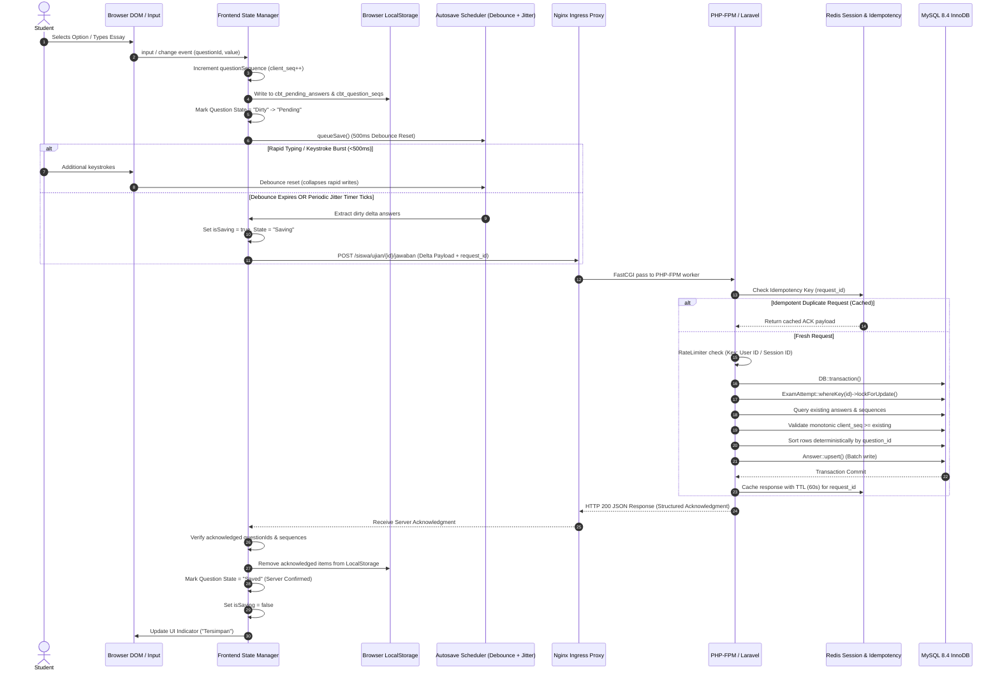
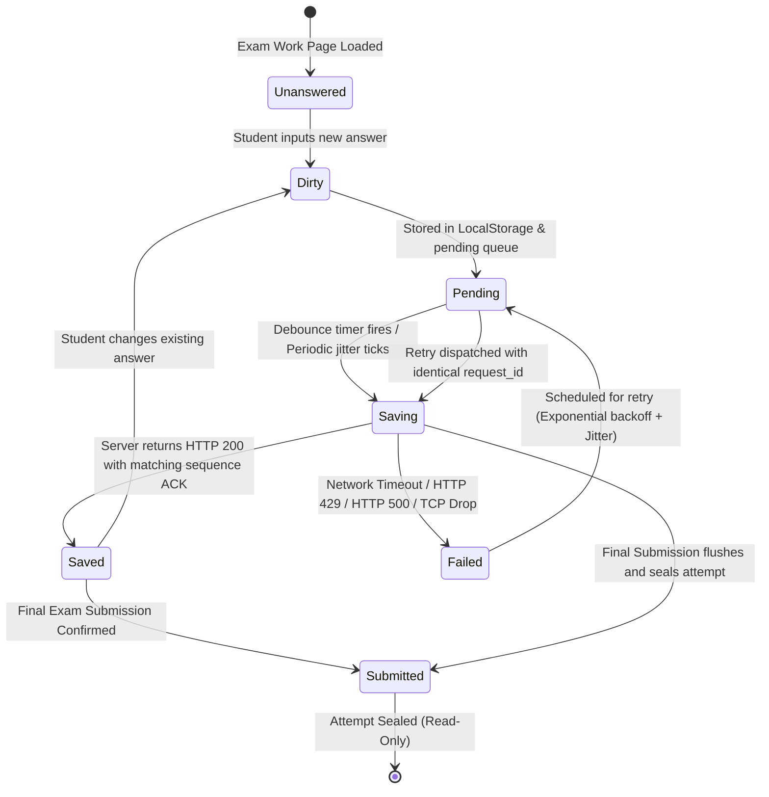

# SMART-CBT — Autosave Data Flow & Lifecycle Specification

**Document Version:** 1.0.0  
**Audit Phase:** Phase 1 Deliverable  
**Author:** Senior Laravel Backend Engineer, Frontend Performance Engineer, & Distributed Systems Engineer  
**Project:** SMART-CBT  
**Working Directory:** `c:/laragon/www/smp-almadinah/smart-cbt`  

---

## 1. Overview

This document specifies the exact data flow, state machine transitions, network payloads, and edge-case lifecycle behaviors for the SMART-CBT autosave system.

The core objective is to transition from a coarse, periodic batch model into an event-driven, delta-based synchronization protocol with rigorous server acknowledgments and zero data loss under network failure.

---

## 2. End-to-End Autosave Lifecycle

The diagram below maps the complete journey of a student's answer mutation from browser DOM input to MySQL InnoDB persistence and back to client acknowledgment.



---

## 3. Client-Side Answer State Machine

To enforce the critical integrity rule that **"the application MUST NOT display 'Saved' merely because a request was dispatched"**, the client tracks each question through an explicit 5-state lifecycle:



### State Definitions & UI Mappings

| State | Internal Trigger | Storage State | Visual UI Indicator |
| :--- | :--- | :--- | :--- |
| **Unanswered** | Question rendered; no value in DB or client | Empty | Question badge neutral |
| **Dirty** | Input modified in DOM; sequence incremented | Memory only | Amber dot / "Ada perubahan..." |
| **Pending** | Written to LocalStorage queue; awaiting flush | Persisted locally | Blue badge / "X pending" |
| **Saving** | HTTP request in-flight to `/jawaban` | In-flight | Blue badge / "Menyimpan..." (Spinning icon) |
| **Saved** | Server ACK received matching exact `client_seq` | Pruned from queue | Emerald badge / "Tersimpan" |
| **Failed** | HTTP error or network drop; retry scheduled | Retained in queue | Red badge / "Gagal (X/3) - Mencoba lagi" |
| **Submitted** | Exam finished and graded | Attempt locked | Green seal / "Ujian Selesai" |

---

## 4. Payload Data Contracts

### A. Current Contract (Legacy)

**Request Payload:**
```json
{
  "answers": {
    "101": "A",
    "102": "Saya setuju dengan..."
  },
  "client_seqs": {
    "101": 5,
    "102": 2
  }
}
```

**Response Payload:**
```json
{
  "saved": true,
  "count": 2
}
```
*Shortcomings:*
- No unique request identifier. Retries cannot be distinguished from fresh requests.
- No correlation data in response. Client must assume all sent answers were accepted.
- No server timestamp.

---

### B. Optimized Delta Contract (Phase 3 & 4 Standard)

The new contract maintains 100% backward compatibility with legacy clients while supporting the optimized delta format.

**Optimized Delta Request:**
```json
{
  "attempt_id": 2361,
  "request_id": "req_01jb2v8z9k4x7w2m1q9a",
  "answers": {
    "101": "B",
    "105": "Analisis dampak perubahan iklim..."
  },
  "client_seqs": {
    "101": 6,
    "105": 3
  }
}
```

**Optimized Structured Acknowledgment Response:**
```json
{
  "saved": true,
  "attempt_id": 2361,
  "request_id": "req_01jb2v8z9k4x7w2m1q9a",
  "count": 2,
  "acknowledged": {
    "101": {
      "client_seq": 6,
      "status": "persisted"
    },
    "105": {
      "client_seq": 3,
      "status": "persisted"
    }
  },
  "rejected": {},
  "server_time": "2026-11-12T20:15:30.145+07:00"
}
```

#### Partial Rejection Handling (Stale Sequence / Conflict)
If question `101` carried a stale sequence ($seq_{\text{incoming}} < seq_{\text{server}}$), the server persists question `105` and returns:
```json
{
  "saved": true,
  "attempt_id": 2361,
  "request_id": "req_01jb2v8z9k4x7w2m1q9a",
  "count": 1,
  "acknowledged": {
    "105": { "client_seq": 3, "status": "persisted" }
  },
  "rejected": {
    "101": { "client_seq": 6, "reason": "stale_sequence", "current_server_seq": 8 }
  },
  "server_time": "2026-11-12T20:15:30.145+07:00"
}
```
*Client Action:*
1. Removes question `105` from `pendingAnswers` and LocalStorage.
2. Updates question `101`'s sequence counter to $8 + 1 = 9$ to allow future edits.

---

## 5. Edge Cases & Concurrency Resolution

### 1. Temporary Network Disconnection
- **Detection:** `window.addEventListener('offline')` or `fetch()` network failure.
- **Client Behavior:**
  - Connection indicator toggles to "Offline - tersimpan di HP".
  - Answers continue accumulating in `state.pendingAnswers` and `localStorage`.
  - Retries pause or back off exponentially with jitter:
    $$\Delta t = \min\left(T_{\max},\; T_{\text{base}} \times 2^{\text{retryCount}}\right) \pm \text{jitter}$$
- **Reconnection:** `window.addEventListener('online')` triggers an immediate flush of all pending items with a fresh `request_id`.

### 2. Tab Backgrounding & Visibility Changes
- When a student switches away from the exam tab (e.g. opens a reference or minimizes the browser):
  ```javascript
  document.addEventListener('visibilitychange', () => {
      if (document.visibilityState === 'hidden') {
          flushPendingDelta({ useKeepalive: true });
      } else if (document.visibilityState === 'visible') {
          syncPendingDelta();
      }
  });
  ```
- Any unsynced dirty answers are immediately dispatched using `fetch(..., { keepalive: true })`.
- When returning, the client checks if any pending answers remain and triggers synchronization.

### 3. Autosave Racing Against Final Submission
- **Scenario:** Student finishes the last question and immediately clicks "Kumpulkan Ujian" while an autosave is currently in-flight.
- **Resolution:**
  1. Frontend sets `state.submitStarted = true`.
  2. If an autosave is active, `executeFinalSubmit()` waits on `activeSavePromise` before proceeding.
  3. All remaining pending answers in `state.pendingAnswers` are written into the form's hidden inputs.
  4. Backend `submitAttemptAnswers()` acquires `ExamAttempt::lockForUpdate()`.
  5. If the autosave finishes first, the submit updates answers and seals status to `submitted`.
  6. If the submit commits first, the attempt status becomes `submitted`. When the autosave transaction unblocks, line 33 throws `InvalidArgumentException('Ujian sudah selesai...')`, preventing any post-submission mutation.
