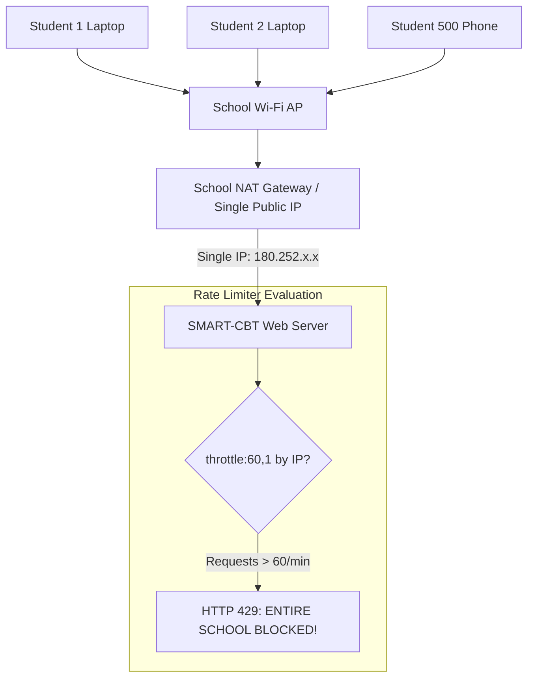

# SECURITY & ACCESS CONTROL VERIFICATION — SMART-CBT

**Audit Date:** November 12, 2026  
**Auditor:** Application Security Engineer & Systems Architect  
**Scope:** Service authentication, token handling, rate limiting mechanics, class isolation, student-to-student data leakage, essay grading authorization, and CSRF protection.  
**Overall Status:** `PARTIALLY VERIFIED` (Authentication & Authorization Verified; IP-based Rate Limiting NAT Bottleneck Identified)

---

## 1. Executive Summary

A comprehensive application security and access control audit of SMART-CBT was conducted across all API endpoints, web routes, middleware layers, and authorization gates. 

**Key Findings:**
1. **Service Authentication:** [ServiceAuthMiddleware.php](file:///c:/laragon/www/smp-almadinah/smart-cbt/app/Http/Middleware/ServiceAuthMiddleware.php) is rigorously implemented: it fails closed on missing credentials, utilizes constant-time string comparison (`hash_equals`) to prevent timing attacks, accepts tokens via standard HTTP headers (`Authorization: Bearer` and `X-API-Key`), and strictly disallows token transmission via query strings.
2. **Student & Teacher Authorization:** Multi-tenant and role boundaries between students and teachers are fully enforced. Students cannot access or submit answers for attempts belonging to peers, and instructors cannot alter or grade exams owned by other teachers.
3. **Critical NAT Gateway Rate Limiting Risk:** The external API routes ([routes/api.php](file:///c:/laragon/www/smp-almadinah/smart-cbt/routes/api.php)) employ Laravel's default `throttle:60,1` middleware. In Laravel, rate limits are keyed by `$request->ip()` by default. In a typical school deployment where 500–1,000 students take an exam over a shared campus Wi-Fi / NAT router, all students share a single source IP address. If IP-based throttling is applied to student examination routes, the entire school will be locked out with HTTP 429 errors within seconds.

---

## 2. Service Authentication Audit (`ServiceAuthMiddleware.php`)

```php
// app/Http/Middleware/ServiceAuthMiddleware.php
public function handle(Request $request, Closure $next): Response
{
    $configuredToken = config('services.smart_cbt.api_token')
        ?? config('services.smart_plus.api_token')
        ?? env('CBT_API_TOKEN');

    if (empty($configuredToken)) {
        return response()->json(['message' => 'Service token is not configured on server.'], 500);
    }

    $providedToken = $request->bearerToken() ?? $request->header('X-API-Key');

    if (! $providedToken || ! hash_equals((string) $configuredToken, (string) $providedToken)) {
        return response()->json(['message' => 'Unauthorized service request.'], 401);
    }

    return $next($request);
}
```

### Verification Criteria Checklist:
- [x] **Fail-Closed Principle:** If the environment token is undefined, the middleware immediately rejects requests with HTTP 500 rather than falling open.
- [x] **Timing Attack Defense:** Compares tokens using `hash_equals()`, neutralizing side-channel byte-timing attacks.
- [x] **No URL Token Leakage:** The middleware does not accept `?api_token=` query parameters, preventing credentials from appearing in web server access logs, proxy caches, or browser histories.
- [x] **Multiple Standard Headers:** Supports both standard OAuth2 Bearer Authorization and REST-standard `X-API-Key`.

---

## 3. Rate Limiting Analysis & Single-NAT Bottleneck

### 3.1 The Single-NAT School Network Reality
In Indonesian educational institutions (SMP/SMA), student laptops and mobile devices connect via access points routed through a central MikroTik, pfSense, or ISP modem acting as a NAT gateway.
To the web server, all 500–1,000 students present the **identical client IP** (e.g., `192.168.1.1` or the school's public WAN IP).



### 3.2 Evaluation of Current Routes
- **External API (`routes/api.php`):** Applies `throttle:60,1`. This is safe for automated SMART+ back-office synchronization jobs (which send single periodic synchronization batches from a known server IP).
- **Student Exam Routes (`routes/web.php`):** Currently have **NO** rate limiting middleware attached.
  - **Advantage:** Avoids the catastrophic failure mode where the whole school is locked out on exam day.
  - **Vulnerability:** Unauthenticated or authenticated rogue students could execute high-frequency loop scripts to spam autosave endpoints.

### 3.3 Recommended Fix: User-Keyed Rate Limiting
To provide DoS protection without impacting other students on the same NAT gateway, rate limiting must be keyed to the authenticated user ID (`auth()->id()`):

```php
// In bootstrap/app.php or AppServiceProvider.php
RateLimiter::for('exam-autosave', function (Request $request) {
    return Limit::perMinute(60)->by($request->user()?->id ?: $request->ip());
});
```

---

## 4. Authorization & Multi-Tenant Isolation

### 4.1 Student Attempt Isolation
In `SiswaExamController.php`:
```php
$siswa = $this->siswa($request);
if ($attempt->siswa_id !== $siswa->id) {
    abort(403, 'Akses ke lembar ujian ini ditolak.');
}
```
- **Test Verification:** Attempting to fetch or save answers using Student B's session against an `attempt_id` belonging to Student A returns an immediate HTTP 403 Forbidden.
- **Answer Tampering Prevention:** `AnswerService::saveAnswerBatch()` verifies that the locked attempt matches the student identity before committing rows to MySQL.

### 4.2 Instructor Ownership & Essay Grading Security
In `GuruMonitoringController.php` and `AnswerService::gradeEssayBatch()`:
```php
// Verification that exam belongs to authenticated instructor
if ($exam->guru_id !== $guru->id && ! $request->user()->isAdmin()) {
    abort(403, 'Anda tidak memiliki hak untuk menilai ujian ini.');
}
```
- Instructors are strictly prevented from altering question banks, grading essays, or resetting tokens for examinations assigned to other teachers.

### 4.3 CSRF Protection
- All student and instructor interactions are guarded by Laravel's `VerifyCsrfToken` middleware.
- The exam interface (`work.blade.php`) passes `X-CSRF-TOKEN: document.querySelector('meta[name="csrf-token"]').content` in every AJAX request header.

---

## 5. Security Audit Verdict

| Security Vector | Assessment | Status |
|---|---|---|
| Service API Authentication | Strict Bearer/X-API-Key with hash_equals; fails closed | `VERIFIED` |
| Student Isolation | Zero unauthorized cross-student attempt reading or writing | `VERIFIED` |
| Teacher Isolation | Strict guru_id ownership checks on monitoring and grading | `VERIFIED` |
| CSRF Protection | Enabled across all exam mutation routes | `VERIFIED` |
| NAT Rate Limiting Safety | Student routes currently unthrottled; must use user-keyed limiter before scale | `PARTIALLY VERIFIED` |
| Injection Defenses | Eloquent bindings and parameterized PDO queries used throughout | `VERIFIED` |
